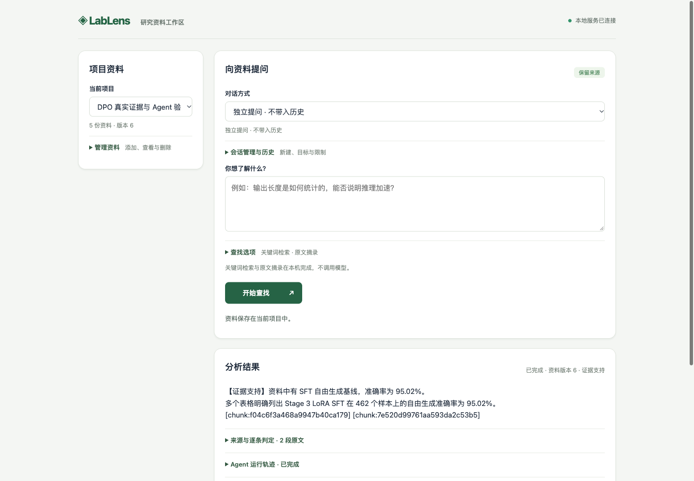

# LabLens

面向研发与模型实验排查的 **RAG / Agent 工作区**。从分散的文档、配置和日志摘要中查找证据，排查“结果为何不同、依据是什么、还缺哪些信息”。

[启动说明](docs/v0.12-workspace.md) · [真实排查案例](docs/cases/dpo-preference-generation.md) · [本轮证据](docs/conversation-round19b-runtime.md) · [文档索引](docs/README.md)

## 核心能力

- **带来源的检索**：BM25、向量与 RRF 混合检索，保留原文片段、偏移及哈希。
- **多轮工具调用**：模型选择检索、读取来源、澄清或提交报告；记录耗时、调用预算与失败轨迹。
- **显式项目记忆**：手动保存和选用，绑定原文版本，处理冲突、过期与删除；备注仍需重新核验。
- **可恢复的任务**：MySQL保存完整工具边界，显式恢复沿用原快照和累计预算；未知请求阻止重放。
- **有权限的协作**：持久登录会话、OWNER/EDITOR/VIEWER、旧资料显式接管和独立服务身份。

## 技术结构

| 组件 | 职责 |
| --- | --- |
| Java 21 / Spring Boot | 登录与工作区权限、任务调度、租约与取消 |
| MySQL / Redis | 资料版本、快照与历史 / 缓存与限流 |
| RabbitMQ（可选） | outbox 投递、inbox 去重与任务唤醒 |
| Python / FastAPI | RAG、Agent 工具循环、来源及数值检查 |
| OpenAI-compatible HTTP | 模型接入、发送许可与调用预算 |

## 运行

完整工作区按 [Compose 或手动启动说明](docs/v0.12-workspace.md)配置，入口为 <http://127.0.0.1:8081>。

只体验确定性工具，可按[本地安装步骤](CONTRIBUTING.md#本地验证)运行[离线示例](docs/demo.md)，无需 API key；真实模型接入见[配置与预算](services/workspace/README.md#configuration)。

## 当前进展

**v0.13 候选，收尾完整交付7/12，第8轮部分完成。** 首次 A6000 私有部署的3次真实兼容请求为2通过、1报告协议失败；随后补充单ID决策、持久配额网关和43项本地跨服务检查，完整私有模型 Agent 仍待验收。[部署与原失败](docs/evaluations/conversation-round19/runtime-run.md) · [本地修复](docs/conversation-round19b.md)

最新一次租用因虚机缺少 AVX 而启动失败，模型调用0次，资源已释放；已补启动前检查，2,485项Python回归通过，尚未再次进行GPU验证。[排查与证据](docs/conversation-round19b-runtime.md)

后续按[十二轮计划](docs/finalization-12-rounds.md)推进。已有十万条合成历史列表响应体减少84.49%的[对照实验](docs/conversation-round14.md)；这些实验不代表生产容量或商业流量。

## 参与与跟进

[Issues](https://github.com/N7766/lablens-agent/issues) · [Pull requests](https://github.com/N7766/lablens-agent/pulls) · [贡献指南](CONTRIBUTING.md) · [更新记录](CHANGELOG.md)
