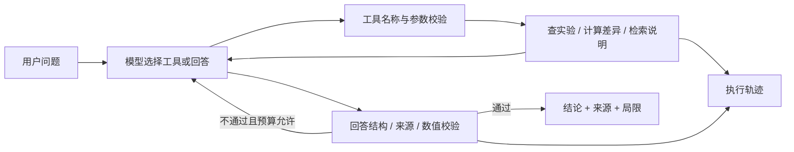

# LabLens — 有证据的实验分析 Agent

把实验摘要与方法说明连接到一个可检查的工具调用循环：提问、查数据、计算差异、检索说明、给出带来源的结论。

[](https://github.com/N7766/lablens-agent/actions/workflows/ci.yml)

[离线演示结果](docs/demo.md) · [评测记录](docs/evaluation.md) · [开发计划](https://github.com/N7766/lablens-agent/issues)

**v0.3：结构化回答、证据化局限与确定性查询。96 项离线测试通过；新题两轮真实对照：Agent 19/22、单次直接7/22、修正版12/22（Codex助手评分；规则题单列）。完整轨迹和已知失败见最新报告。尚无独立人工审核。**

[五步交付计划](docs/v0.3-plan.md) · [v0.3 真实评测](docs/v0.3-evaluation.md) · [设计与边界](docs/v0.3-design.md) · [三分钟演示](docs/walkthrough.md) · [版本下载](https://github.com/N7766/lablens-agent/releases)

历史：[v0.2 单次对照](docs/v0.2-evaluation.md) · [最初三题联调](docs/deepinfra-validation.md)。旧失败记录保留，不用新结果覆盖。

例如：问“DPO 比 SFT 好多少，能不能说显著提升？”Agent 可以读取实验、调用确定性计算工具、查找验证集与显著性说明，再组织结论。数字由 Python 计算，模型负责选择工具与解释证据。

## 为什么做这个项目

模型实验散落在 JSON 和报告里，容易出现比较口径不一致、验证集被写成测试集、词数误称 token 数等问题。本项目以个人 DPO 实验的 11 条真实摘要为起点，将指标比较、方法说明检索与引用检查连接起来。

## 已实现

- **5 个只读工具**：`list_runs`、`compare_runs`、`search_notes`、`query_runs`、`describe_data`；另有 `submit_answer` 提交最终结构化答案。
- **模型自主工具调用循环**：Chat Completions 兼容接口；模型选择工具并接收结果，可修正参数或最终输出。无需 Agent 框架即可理解完整执行路径。
- **确定性对比与查询**：指标差值、复合筛选、排序并列与 Pareto 集合；拒绝不兼容数据，核对最终查询集合及顺序。
- **BM25 词法检索**：英文词项与中文双字切分；检索 6 条方法说明。当前没有向量检索、重排或大规模 RAG 效果证据。
- **约束与轨迹**：最多8次模型 / 12次工具调用（含答案提交）、来源与数值校验、重复无效提交停止；局限由已读说明生成。显式动作命令使用共享只读规则，零模型调用单独显示。
- **FastAPI 本地演示页**：显示回答、来源、模型及工具事件；支持下载轨迹。
- **评测与导入**：96 项离线测试、旧题回归与12道新组合题、Agent / 单次直接 / 8次修正版三组各重复两次、调用前冻结 manifest；[通用实验格式](docs/import-format.md)和明确标注的合成夹具。

## 快速启动

Python 3.11+。在仓库根目录运行：

```bash
python3 -m venv .venv
source .venv/bin/activate
pip install -e '.[dev]'
pytest -q
lablens demo --output reports/offline-demo.json
uvicorn lablens.api:app --host 127.0.0.1 --port 8765
```

打开 <http://127.0.0.1:8765>，点击“查看固定离线演示”。演示固定比较 SFT 与最优 DPO，不使用输入框中的问题，不调用真实模型，也不产生模型任务成功率。

如果安装了 uv，可用 `uv sync --locked --extra dev` 安装锁定依赖，再通过 `uv run lablens demo` / `uv run uvicorn lablens.api:app --host 127.0.0.1 --port 8765` 启动。Mac 的 Python 证书配置异常时，可用 `uv --native-tls sync --locked --extra dev` 使用系统信任库。

## 配置真实模型

```bash
cp .env.example .env
# 在本地编辑 .env 中的 LLM_BASE_URL、LLM_MODEL、LLM_API_KEY
lablens ask '比较 SFT 和最优 DPO，说明准确率、长度和结论边界。' --output reports/live-first.json
python scripts/evaluate.py --limit 3
```

示例配置面向 DeepInfra 的 `Qwen/Qwen3-235B-A22B-Instruct-2507`，真实运行记录见评测报告。`LLM_TIMEOUT_SECONDS` 可设置 1–180 秒；未设置时为 45 秒，超时后不自动重试。也可填写其他兼容工具调用的接口与模型，`LLM_BASE_URL` 为 `/chat/completions` 前的地址。不同供应商需要实际联调，不能假定所有兼容接口行为一致。模型收到用户问题、相关工具定义及本次工具返回的摘要/说明。`.env` 和 `reports/` 已加入忽略规则。

缺少密钥时真实模式明确报错，不会回退到脚本演示。密钥只保存在本地；不需要在聊天中发送。

## 结构



| 文件 | 职责 |
| --- | --- |
| `lablens/agent.py` | 有界执行循环、修正反馈、引用检查 |
| `lablens/tools.py` | 只读工具、确定性计算、BM25 |
| `lablens/model.py` | 真实 HTTP 适配器及独立的脚本回放 |
| `lablens/schemas.py` | 参数与回答的 Pydantic 契约 |
| `lablens/api.py` | 本地 HTTP 服务 |
| `lablens/data/` | 标准化摘要、方法说明、来源哈希 |
| `scripts/import_dpo.py` | 从原实验仓库复核并导入摘要 |
| `scripts/evaluate.py` | 真实模型运行与评测记录 |
| `docs/demo.md` | 可复现的离线演示与工具轨迹 |
| `docs/evaluation.md` | 已验证结果和真实模型评测计划 |

## 数据与结论边界

- 数据为个人 `dpo-cot-compression` 项目的摘要快照，导入时核对每个 Stage 5 汇总与对应原始 summary；去除 `final` 与编号检查点的重复别名。
- 导入后共有 11 个记录、6 条方法说明；`provenance.json` 记录原文件相对路径与 SHA-256。公开仓库仅含数值摘要，不含模型权重、训练样本或原项目绝对路径。
- 原字段 `avg_output_tokens` 实际由 `len(prediction.split())` 计算；本项目明确写作 `whitespace_words`。
- 当前对比：439/462 → 442/462，增加约 0.649 个百分点；32.4221 → 31.5281 个词，减少约 2.7572%。这些是原 DPO 实验数值，**不是本 Agent 的效果指标**。
- 数据来自参与检查点选择的验证集；无法据此宣称独立测试泛化效果、统计显著性、时延或显存收益。
- 来源检查保证 ID 被本次工具读取，结构化数值检查核对值、单位和比较顺序。它们不能保证全部自然语言结论得到引用支持，仍需审核；具体边界见[数值校验说明](docs/numeric-validation.md)。
- 提供的是单请求、无持久会话记忆的 Agent；没有生产部署、长期记忆、多 Agent 或线上用户证据；离线助手评分不能当作线上成功率。
- 服务用于本机演示，默认绑定回环地址；当前没有公网鉴权、用户隔离、并发费用配额等部署能力。

## 评测

`pytest -q` 检查工程逻辑；真实评测单独运行，会产生模型调用费用：

```bash
python scripts/evaluate.py --cases evaluation/regression-v0.3.json --limit 10 --workers 4
python scripts/evaluate.py --cases evaluation/benchmark-v0.3.json --split holdout --limit 12 --strategy all --repeats 2 --workers 4
python scripts/audit_traces.py reports/eval-替换为本次目录
```

每次调用前冻结代码、数据、提示词与 rubric 哈希。旧题现在用于回归，新题为同一小型项目的新组合，不是外部独立测试。直接方案读取全部原始数据；单次版调用一次，修正版与Agent均最多8次，修正版还能获得相同验证器的确定性反馈。共享规则拒绝不算模型任务成绩。报告比较质量、时间与费用，不把工具调用率当作成功率。

详见 [v0.3 报告](docs/v0.3-evaluation.md)。`manual_*` 保持空值，Codex 助手核对另存 `assistant-review.json`；没有独立人工审核，单次运行也不能支持统计优势结论。

## 迭代与反馈

当前版本的实现、真实评测与失败轨迹均已保留，交付记录见 [Issues](https://github.com/N7766/lablens-agent/issues?q=is%3Aissue)。后续以真实使用反馈和新增实验驱动迭代，维护方式见 [GitHub 展示说明](docs/github-maintenance.md)。欢迎提交带复现输入和预期行为的问题；请勿在 Issue 或轨迹中包含密钥或私人资料。

相关项目：[DPO 推理链压缩](https://github.com/N7766/dpo-cot-compression) · [拾题 macOS 应用](https://github.com/N7766/QuestionGlass)。

## 实现参考

- [DeepSeek 工具调用协议](https://api-docs.deepseek.com/guides/tool_calls/)
- [FastAPI TestClient 文档](https://fastapi.tiangolo.com/tutorial/testing/)
