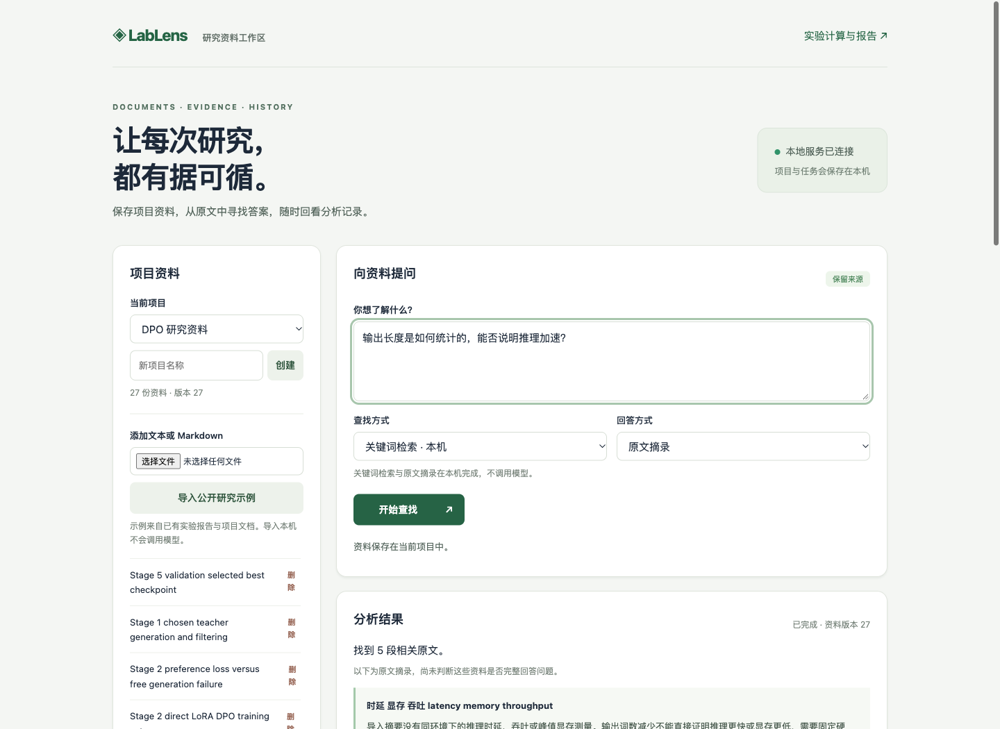
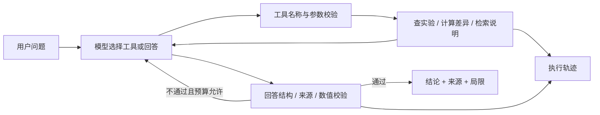
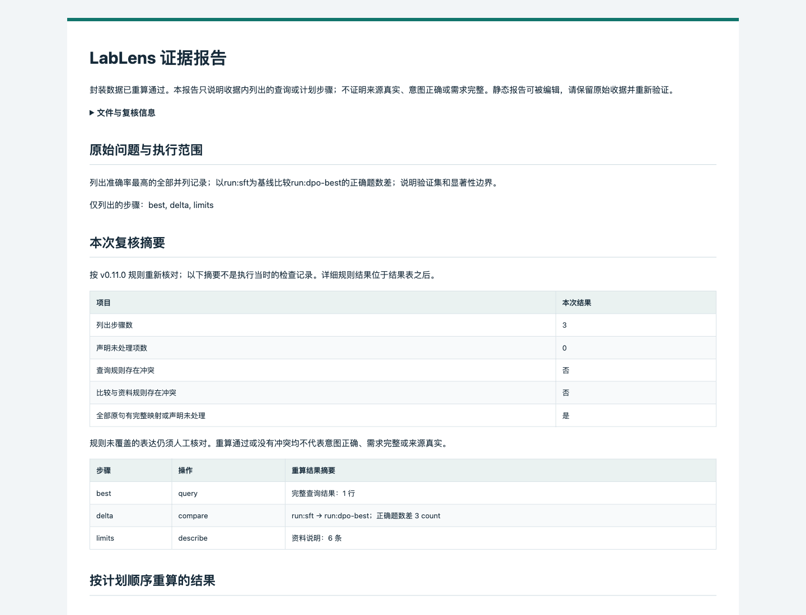

# LabLens — 有证据的实验分析 Agent

把实验摘要与方法说明连接到一个可检查的工具调用循环：提问、查数据、计算差异、检索说明、给出带来源的结论。

[](https://github.com/N7766/lablens-agent/actions/workflows/ci.yml)

[离线演示结果](docs/demo.md) · [评测记录](docs/evaluation.md) · [开发计划](https://github.com/N7766/lablens-agent/issues)

**v0.12：新增 Java / MySQL / Redis 持久研究工作区，支持版本化资料、幂等异步任务、有界并发、BM25 / 真实向量 / 混合检索和带引用回答。实际检索、并发与进程故障测试分开记录。**

[工作区启动与架构](docs/v0.12-workspace.md) · [实测指标与失败分析](docs/v0.12-evaluation.md) · [实现计划](docs/v0.12-plan.md) · [JVM 服务](services/workspace/README.md)

验证：520项Python测试、32项Java测试；真实数据库故障回归8类/37项断言；修复并发死锁后三轮96/96任务完成。27份资料上的预留题Recall@5为BM25 **0.708**、dense **1.000**、hybrid **0.875**；仅为12道可回答题的小样本结果。首次并发失败和1次真实模型错误拒答均保留。



旧实验计算与报告仍保留：

[本轮更新计划](docs/v0.11-plan.md) · [报告导出说明](docs/v0.11-workbench.md) · [离线验收与边界](docs/v0.11-evaluation.md) · [示例报告](docs/reports/v0.11/README.md) · [版本下载](https://github.com/N7766/lablens-agent/releases)

历史：[v0.10比较与资料规则](docs/v0.10-evaluation.md) · [v0.9选择范围协议](docs/v0.9-evaluation.md) · [v0.8跨快照验证](docs/v0.8-evaluation.md) · [v0.7请求规则与修正失败](docs/v0.7-evaluation.md) · [v0.6规划预算对照](docs/v0.6-evaluation.md) · [v0.5混合任务](docs/v0.5-evaluation.md) · [v0.4查询表格对照](docs/v0.4-evaluation.md) · [v0.3三组重复对照](docs/v0.3-evaluation.md) · [v0.2单次对照](docs/v0.2-evaluation.md) · [最初三题联调](docs/deepinfra-validation.md)。旧失败记录保留。


例如：问“DPO 比 SFT 好多少，能不能说显著提升？”Agent 可以读取实验、调用确定性计算工具、查找验证集与显著性说明，再组织结论。数字由 Python 计算，模型负责选择工具与解释证据。

## 为什么做这个项目

模型实验散落在 JSON 和报告里，容易出现比较口径不一致、验证集被写成测试集、词数误称 token 数等问题。本项目以个人 DPO 实验的 11 条真实摘要为起点，将指标比较、方法说明检索与引用检查连接起来。

## 已实现

- **5 个只读工具**：`list_runs`、`compare_runs`、`search_notes`、`query_runs`、`describe_data`；另有 `submit_answer` 提交最终结构化答案。
- **模型自主工具调用循环**：Chat Completions 兼容接口；模型选择工具并接收结果，可修正参数或最终输出。无需 Agent 框架即可理解完整执行路径。
- **确定性对比与查询**：指标差值、复合筛选、排序并列与 Pareto 集合；拒绝不兼容数据，核对最终查询集合及顺序。
- **两条检索路径**：旧工具使用 BM25 检索 6 条方法说明；新文档工作区支持分块、BM25、真实 embedding 精确余弦检索和 RRF 混合排序。固定公开资料上的小型对照见 v0.12，不宣称大规模 RAG 效果。
- **JVM 持久工作区**：Java 21 / Spring Boot、MySQL 文档版本与不可变任务快照、幂等冲突、租约与迟到写入保护；Redis TTL 缓存及 Lua 限流；Micrometer 运行指标。
- **RAG 回答与来源**：原文偏移、引用哈希、可选真实生成，当前调用用量与缓存历史用量分开。缺少模型配置明确失败，不用伪向量替代。
- **约束与轨迹**：最多8次模型 / 12次工具调用（含答案提交）、来源与数值校验、重复无效提交停止；局限由已读说明生成。显式动作命令使用共享只读规则，零模型调用单独显示。
- **可核对分析计划**：最多2次模型请求、最多6步查询/比较/资料说明；显式all/top-k/极值选择与独立升降序编译、分句关联与矛盾检查、参数预览和receipt重算。有限完整句式核对查询条件、明确命名比较的方向及资料操作；未知表达明确未核对，查询引用为空或并列时拒绝默认选择。
- **导入数据规划**：模型与预览使用单次请求内的规范化数据副本；快照绑定发送选择与执行。切换数据清除旧草稿及许可，忽略迟到的回复；模型数据正文上限128 KiB，手动查询不受此模型限制。
- **可分享的分析报告**：当前查询/计划或历史收据先验证重算，再导出自包含HTML与Markdown；完整有序结果、原文资料、来源、未处理与当前规则冲突全部保留。报告可编辑，不是签名或来源认证。
- **FastAPI 本地演示页**：显示回答、来源、模型及工具事件；支持数据导入、条件预览、完整表格、轨迹和可复核结果下载。
- **评测与导入**：520 项Python离线测试；v0.11覆盖166份历史收据与22类报告边界，0次新增模型调用。v0.10的真实开关对照和受控修正另行保留冻结输入、原始消息、首轮失败和费用；支持[通用实验格式](docs/import-format.md)。

## 快速启动

Python 3.11+。在仓库根目录运行：

```bash
python3 -m venv .venv
source .venv/bin/activate
pip install -e '.[dev]'
pytest -q
lablens demo --output reports/offline-demo.json
uvicorn lablens.api:app --host 127.0.0.1 --port 8765
```

打开 <http://127.0.0.1:8765>，默认进入不调用模型的条件查询。切换“分析计划”可以载入合成数据的离线三步示例，也可以导入自己的JSON；勾选发送当前数据后，再用模型生成待核对草稿。三个内置离线示例会先切回内置DPO数据。也可切换“Agent分析”，点击“固定离线演示”。演示固定比较 SFT 与最优 DPO，不使用输入框中的问题，不调用真实模型，也不产生模型任务成功率。

如果安装了 uv，可用 `uv sync --locked --extra dev` 安装锁定依赖，再通过 `uv run lablens demo` / `uv run uvicorn lablens.api:app --host 127.0.0.1 --port 8765` 启动。Mac 的 Python 证书配置异常时，可用 `uv --native-tls sync --locked --extra dev` 使用系统信任库。

## 配置真实模型

```bash
cp .env.example .env
# 在本地编辑 .env 中的 LLM_BASE_URL、LLM_MODEL、LLM_API_KEY
lablens ask '比较 SFT 和最优 DPO，说明准确率、长度和结论边界。' --output reports/live-first.json
python scripts/evaluate.py --limit 3
```

示例配置面向 DeepInfra 的 `Qwen/Qwen3-235B-A22B-Instruct-2507`，真实运行记录见评测报告。`LLM_TIMEOUT_SECONDS` 可设置 1–180 秒；未设置时为 45 秒，超时后不自动重试。也可填写其他兼容工具调用的接口与模型，`LLM_BASE_URL` 为 `/chat/completions` 前的地址。不同供应商需要实际联调，不能假定所有兼容接口行为一致。模型收到用户问题、相关工具定义及本次工具返回的摘要/说明。`.env` 和 `reports/` 已加入忽略规则。

缺少密钥时真实模式明确报错，不会回退到脚本演示。密钥只保存在本地；不需要在聊天中发送。

## 查询与离线复核

在“条件查询”导入自己的实验JSON，预览参数并执行；下载的结果文件封装数据、条件和结果，可重新计算。此模式不调用模型。更改参数或数据后需重新预览。

```bash
lablens inspect
lablens query --query-file query.json --output result.json
lablens verify result.json
lablens report result.json --format html --output report.html
lablens report result.json --format markdown --output report.md
```

`query.json`示例：`{"order_by":"correct","descending":false,"top_k":1,"include_ties":true}`。哈希验证内部一致性，不证明数据来源真实性。详细格式和自定义数据用法见[工作台说明](docs/v0.4-workbench.md)。

## 结构



| 文件 | 职责 |
| --- | --- |
| `lablens/agent.py` | 有界执行循环、修正反馈、引用检查 |
| `lablens/tools.py` | 只读工具、确定性计算、BM25 |
| `lablens/model.py` | 真实 HTTP 适配器及独立的脚本回放 |
| `lablens/schemas.py` | 参数与回答的 Pydantic 契约 |
| `lablens/guided_planning.py` / `selection_planning.py` / `plan_checks.py` | 选择范围与排序分离、有界修正与原文分句关联 |
| `lablens/request_checks.py` / `task_checks.py` | 有限查询、命名比较方向及资料操作核对，未知语法保守跳过 |
| `lablens/planning_context.py` | 当前数据的规范化副本、模型输入范围和大小限制 |
| `lablens/planning.py` | 可编辑计划、前置查询引用、预览绑定与执行重算 |
| `lablens/reporting.py` | 先验证收据再生成离线HTML/Markdown，保留完整证据及边界 |
| `lablens/api.py` | 本地 HTTP 服务 |
| `lablens/data/` | 标准化摘要、方法说明、来源哈希 |
| `scripts/import_dpo.py` | 从原实验仓库复核并导入摘要 |
| `scripts/evaluate_tasks.py` / `evaluate_selection.py` | 冻结开关/协议对照，首次与最终分数、独立故障注入 |
| `docs/demo.md` | 可复现的离线演示与工具轨迹 |
| `docs/evaluation.md` | 已验证结果和真实模型评测计划 |

## 数据与结论边界

- 数据为个人 `dpo-cot-compression` 项目的摘要快照，导入时核对每个 Stage 5 汇总与对应原始 summary；去除 `final` 与编号检查点的重复别名。
- 导入后共有 11 个记录、6 条方法说明；`provenance.json` 记录原文件相对路径与 SHA-256。公开仓库仅含数值摘要，不含模型权重、训练样本或原项目绝对路径。
- 原字段 `avg_output_tokens` 实际由 `len(prediction.split())` 计算；本项目明确写作 `whitespace_words`。
- 当前对比：439/462 → 442/462，增加约 0.649 个百分点；32.4221 → 31.5281 个词，减少约 2.7572%。这些是原 DPO 实验数值，**不是本 Agent 的效果指标**。
- 数据来自参与检查点选择的验证集；无法据此宣称独立测试泛化效果、统计显著性、时延或显存收益。
- 来源检查保证 ID 被本次工具读取，结构化数值检查核对值、单位和比较顺序。它们不能保证全部自然语言结论得到引用支持，仍需审核；具体边界见[数值校验说明](docs/numeric-validation.md)。
- 原工具调用 Agent 仍按单请求工作；新增项目、文档和任务持久化，不等于会话长期记忆。没有生产部署、多 Agent 或线上用户证据；助手编写问题和评审不能当作独立用户评测。
- 服务用于本机演示，默认绑定回环地址。新工作区有数据作用域、每进程并发限制与每项目队列/限流，尚无公网身份鉴权、分布式全局配额或互联网多租户保证。

## 评测

`pytest -q` 检查工程逻辑；真实评测单独运行，会产生模型调用费用：

```bash
python scripts/evaluate.py --cases evaluation/regression-v0.3.json --limit 10 --workers 4
python scripts/evaluate.py --cases evaluation/benchmark-v0.4.json --split holdout --limit 4 --strategy all --repeats 2 --workers 4
python scripts/audit_traces.py reports/eval-替换为本次目录
```

每次调用前冻结代码、数据、提示词与 rubric 哈希。旧题现在用于回归，新题为同一小型项目的新组合，不是外部独立测试。直接方案读取全部原始数据；单次版调用一次，修正版与Agent均最多8次，修正版还能获得相同验证器的确定性反馈。共享规则拒绝不算模型任务成绩。报告比较质量、时间与费用，不把工具调用率当作成功率。

v0.11的验收针对导出、历史兼容和反例，报告生成模型调用为0，不产生新的模型效果指标。[离线验收记录](docs/v0.11-evaluation.md)。

v0.10在已有DPO真实摘要和Atlas合成快照上编写6道新组合题，两组各重复两次：**关闭新检查首次/最终12/12，开启后首次11/12、最终12/12**。唯一自然修正由已有分句校验触发，新任务规则没有在这批自然样本中触发冲突，不能宣称新增检查提高成功率。

另将方向反转、资料操作错误和重复比较作为预声明人为故障，每例只允许一次真实替换，3/3通过。这是具体受控案例的修复证据，不是自然错误恢复率。题目与数据非独立外部测试，复核为参与实现的助手非盲复核。[完整报告、费用、首轮失败与边界](docs/v0.10-evaluation.md)。

```bash
# 离线参考计划，0模型调用
python scripts/evaluate_tasks.py --repeats 1
# 自然对照：6题×2组×2次，最多48次请求，会产生费用
python scripts/evaluate_tasks.py --live --repeats 2 --workers 2
# 单列受控修正：3个人为错误，最多3次真实请求
python scripts/evaluate_tasks.py --suite controls --live --workers 2
```



## 迭代与反馈

当前版本的实现、真实评测与失败轨迹均已保留，交付记录见 [Issues](https://github.com/N7766/lablens-agent/issues?q=is%3Aissue)。后续以真实使用反馈和新增实验驱动迭代，维护方式见 [GitHub 展示说明](docs/github-maintenance.md)。欢迎提交带复现输入和预期行为的问题；请勿在 Issue 或轨迹中包含密钥或私人资料。

相关项目：[DPO 推理链压缩](https://github.com/N7766/dpo-cot-compression) · [拾题 macOS 应用](https://github.com/N7766/QuestionGlass)。

## 实现参考

- [DeepSeek 工具调用协议](https://api-docs.deepseek.com/guides/tool_calls/)
- [FastAPI TestClient 文档](https://fastapi.tiangolo.com/tutorial/testing/)
