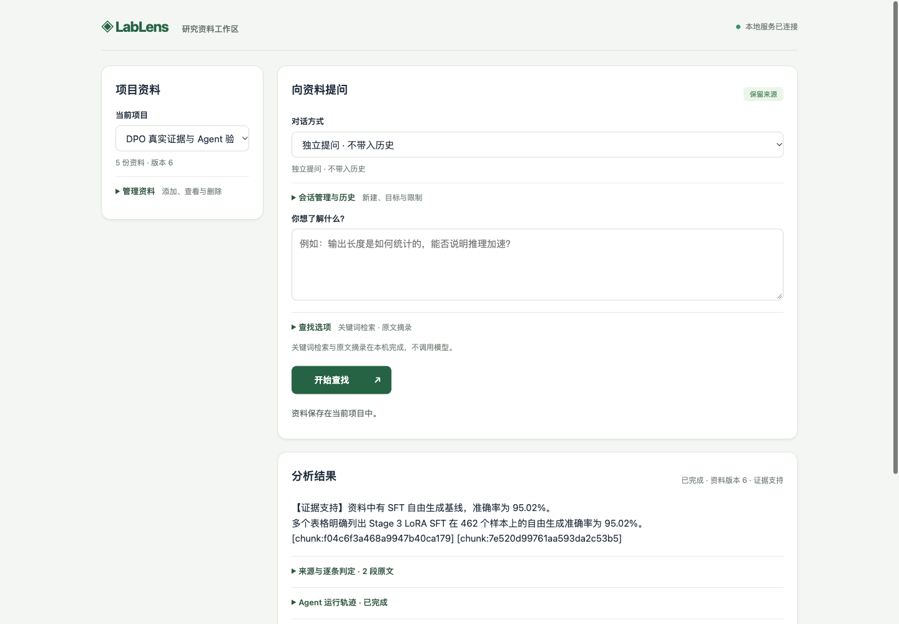

# LabLens

面向研发与模型实验排查的 **RAG / Agent 工作区**。从分散的文档、配置和日志摘要中查找证据，排查“结果为何不同、依据是什么、还缺哪些信息”。

[启动说明](docs/v0.12-workspace.md) · [真实排查案例](docs/cases/dpo-preference-generation.md) · [评测记录](docs/conversation-round6.md) · [文档索引](docs/README.md)

## 核心能力

- **带来源的检索**：BM25、向量与 RRF 混合检索，保留原文片段、偏移及哈希。
- **多轮工具调用**：模型选择检索、读取来源、澄清或提交报告；记录耗时、调用预算与失败轨迹。
- **可回看的任务**：资料版本与任务快照绑定，支持幂等提交、取消、会话和历史持久化。

## 技术结构

| 组件 | 职责 |
| --- | --- |
| Java 21 / Spring Boot | 工作区 API、任务调度、租约与取消 |
| MySQL / Redis | 资料版本、快照与历史 / 缓存与限流 |
| Python / FastAPI | RAG、Agent 工具循环、来源及数值检查 |
| OpenAI-compatible HTTP | 模型接入、发送许可与调用预算 |

## 运行

完整工作区按 [Compose 或手动启动说明](docs/v0.12-workspace.md)配置，入口为 <http://127.0.0.1:8081>。

只体验确定性工具，可按[本地安装步骤](CONTRIBUTING.md#本地验证)运行[离线示例](docs/demo.md)，无需 API key；真实模型接入见[配置与预算](services/workspace/README.md#configuration)。

## 当前进展

**v0.13 候选，尚未正式发布。** 第六轮改进回答覆盖、计算与证据范围，并保留优化中的回归和排查过程。真实模型验收仍未通过，候选留在草稿 PR，主服务保留上一版。详见[结果与原始证据](docs/conversation-round6.md)及[工程迭代记录](docs/engineering-journal.md)。

目前为本机单用户原型，无公网鉴权；MQ、自动长期记忆、步骤级恢复和 GPU 私有部署列入[后续路线](docs/backend-llm-capability-roadmap.md)，尚未完成。

## 参与与跟进

[Issues](https://github.com/N7766/lablens-agent/issues) · [Pull requests](https://github.com/N7766/lablens-agent/pulls) · [贡献指南](CONTRIBUTING.md) · [更新记录](CHANGELOG.md)
