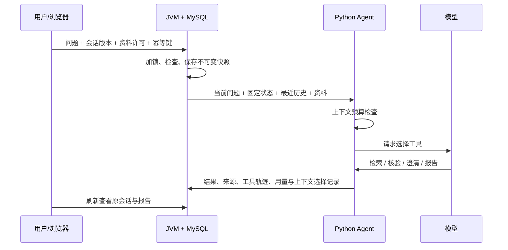

# LabLens 会话第一轮：实现、验收与简历边界

日期：2026-10-29。开发起点 `83f7ab1`；本轮没有发布新的正式版本。下列真实模型测试使用本地 JVM/Python/MySQL/Redis 和 DeepInfra 的 `Qwen/Qwen3-235B-A22B-Instruct-2507`，不是生产服务或外部人工验收。

**结论：会话与上下文机制已落地，新场景质量验收尚未通过。** 开发演示能完成三轮查证与刷新回看；两组新场景及后续开发重跑没有完整完成三轮，不能将局部成功写成稳定的多轮 Agent。

## 做成了什么

单次报告扩展为可跨请求追问的研究会话。用户可先问 SFT，再问“和刚才基线相比”，更正讨论对象后继续；刷新页面可以查看原会话、完整报告、资料版本和工具轨迹。

| 层次 | 实现与工程约束 |
|---|---|
| JVM / MySQL | Flyway V4 增加 conversations 与 task 关联；事务按 workspace→conversation 加锁；期望版本检查；同会话只接受一个活动任务；幂等重放先于陈旧/忙碌检查 |
| 短期状态 | 用户填写目标、限制、当前对象；随接受的 turn 原子保存。模型回答不会自动修改这些状态，也不成为事实记忆 |
| 历史快照 | 每轮固定资料和会话版本；携带最近20个终态问答，答案上下文上限4000字符，原完整报告不变；失败轮不会填入虚构答案 |
| Python 上下文 | 以序列化 UTF-8 字节加 framing 做保守估算，默认65536 units，预留2600输出与1024余量；计入工具定义、JSON schema、模型名和调用选项。不是精确 tokenizer 或供应商窗口保证 |
| 超限策略 | 按整轮删旧问答、按完整工具调用/结果组删旧交换；保留最近两轮、当前问题、固定状态、已观察来源索引。仍超限则在下次供应商调用前明确停止，不静默截断证据 |
| 工具协议 | 新增已检索来源的限量重读及澄清工具。澄清是结束当前轮的正常结果；协议错误、预算不足保存为失败；不自动重试未知结果 |
| 前端 | 独立提问与多轮会话并存；发送许可绑定资料、问题、会话版本和状态；陈旧状态保留草稿；不确定提交保留原请求体和幂等键供手动确认 |

旧回答仅用于解析指代；每轮事实仍需查询当前资料。超出最近20轮或预算删除的历史明确标记省略，没有自动摘要。重要长期约束应由用户固定在状态中，不能承诺所有自由文本约束无限保留。

## 已完成的验证

| 验证 | 结果 | 可证明的范围 |
|---|---:|---|
| Python 全量回归 | 628 passed | 协议、预算、检索、证据及既有行为；离线受控用例 |
| JVM | 53个不同测试通过，其中28个真实 MySQL/Redis集成测试 | 事务、会话隔离、幂等、历史、失败身份及已有服务行为；没有调用真实模型 |
| 前端 DOM | 32 passed | 状态、许可、乱序返回和提交回包丢失时的幂等键保留 |
| 实际超限故障 | 26/26检查，供应商请求0 | 真 JVM→Python→MySQL；首个请求前拒绝，保存准确错误码、来源身份、零用量；刷新/SQL/幂等重放一致 |
| 真实浏览器 DPO 对话 | 连续3轮完成，另1轮正确澄清 | SFT→Stage4追问→Stage5更正；保存限制；JVM重启、刷新后历史和完整报告可重开；390px无横向溢出 |
| 已知生成问题最终回归 | 2/2目标命题通过 | SFT基线存在、配置不证明历史执行、验证集口径。第一次回归仍有单位误标，原结果保留 |

JVM是在完整52项运行后，再运行包含新增诊断轨迹测试的14项 WorkerResults 测试，共53项不同测试；并非把重跑次数累计。Python 有一条既有 Starlette 弃用提醒。浏览器前三轮是在最后的工具调用选项加固前完成，澄清和超限复核使用最终 Python；各任务保留实现指纹。

证据：[JVM](evaluations/conversation-round1/jvm-final.json)、[超限故障](evaluations/conversation-round1/budget-fault-final/README.md)、[浏览器](evaluations/conversation-round1/browser/summary.json)、[已知问题语义复核](evaluations/conversation-round1/known-generation-grades.json)。截图：[桌面](evaluations/conversation-round1/browser/desktop.png)、[移动端](evaluations/conversation-round1/browser/mobile.png)、[持久报告](evaluations/conversation-round1/browser/report.png)。

## 检索与回答质量

增加有限的中英文研究术语归一化和 Stage 编号归一化，保留原文与来源位置。固定资料、分块、BM25打分和top5，仅替换分词的离线对照中，旧的12道公开题：完整必需文档组覆盖从 **3/12→6/12**，文档组命中从 **3/22→14/22**。这是已曝光开发题的文档级覆盖，不是事实片段召回、语义准确率或通用跨语言检索能力。仍有6题未覆盖全部必需文档组。[原始双臂结果](evaluations/conversation-round1/retrieval-public-regression/results.json)

新增验证/测试集标签和已知空格分词实现的单位防护，遇到冲突降为证据不足。规则很窄，不认证任意自然语言推理。最终两道生成回归没有再输出长度结论，因此该次真实调用没有覆盖单位防护；单位分支由受控回归测试覆盖。

未参与实现的代理先冻结2个合成场景、8份英文资料、6个中文轮次及金标，再通过真实API测试。**首次新题验收失败**：两个首轮均工具协议错误（0/2完成），4个依赖轮次未执行；已经执行的两个问题检索到了必需文档，但没有最终答案，不能计算答案正确率或误拒答率。6次模型调用，30091 tokens。原始封存包和评分不覆盖、不删除。[独立代理新题结果](evaluations/conversation-round1/new-scenarios/README.md)

之后新增 `tool_choice="required"` 请求选项和拒绝决策诊断；若模型仍不返回有效工具调用，依旧明确失败。DeepInfra [官方工具调用文档](https://docs.deepinfra.com/chat/tool-calling)没有承诺 required 的通用强制效果，这里依靠实际返回检查，不把一个请求参数当作可靠性保证。最初失败缺少原始无效决策内容，只能确认在检索/核验后发生协议错误，不能反推精确根因。

已曝光题组的后续执行单独作为[开发回归](evaluations/conversation-round1/exposed-scenarios-regression/README.md)：4轮实际提交，2成功、1超时、1工具协议错误，2个依赖轮次阻断，**0/2完整三轮场景通过**。已交付的2份答案核心事实正确，但正文均漏掉冻结要求中的“合成/本地评估”范围限定，严格全条件0/4通过。必需文档4/4检索到；这不能替代结论和范围正确性。

该次14次模型调用，已知 token 下界68529，超时调用用量未知，完整总量为null。失败澄清轮的第三次决策明确记录 `finish_reason=stop`、无工具调用、无正文；请求设置 required 仍不能保证有效返回。最初独立失败包保持不变；后续同题不能标为新盲测或人工独立评测。

## 本轮范围与下一轮

第一轮交付的是可运行的会话/短期状态/预算机制与验收证据。没有自动事实摘要、精确 tokenizer、长期向量记忆、SSE、步骤检查点、暂停取消或故障后续跑。模型事实质量仍需继续验证。

继续迭代时先收敛本轮失败：供应商无有效工具返回、长检索链超过75秒预算、答案遗漏用户固定范围限定；用不同新题复验。再进入第二轮的工具边界事件、取消与明确恢复语义、断线重连，继续保留外部调用未知结果；第三轮再做有来源、有效期、冲突处理和可删除的项目长期记忆。参见[三轮规划](conversation-and-recovery-plan.md)。

本地8081/8765服务已更新，Flyway V4迁移前备份数据库；更新后原182项任务、13个工作区、42份资料数量一致。[迁移验证](evaluations/conversation-round1/main-migration.json)

## 可用于简历的表述

> 为研究诊断 Agent 实现 MySQL 持久化多轮会话与用户固定短期状态，通过事务版本锁、幂等请求及不可变资料快照防止重复提交和上下文串用；实现工具/历史完整组裁剪与调用前上下文预算检查，并用真实 JVM→Python→MySQL 故障测试验证超限零外部调用和失败历史可追溯。

面试可演示三轮查证、用户纠正、刷新回看与超限停止，说明为什么历史答案不能当证据。可以引用各自范围内的本地测试结果和检索开发对照；不能写“长短期记忆系统已完成”“多轮准确率100%”“生产级上下文管理”或“解决幻觉”。
