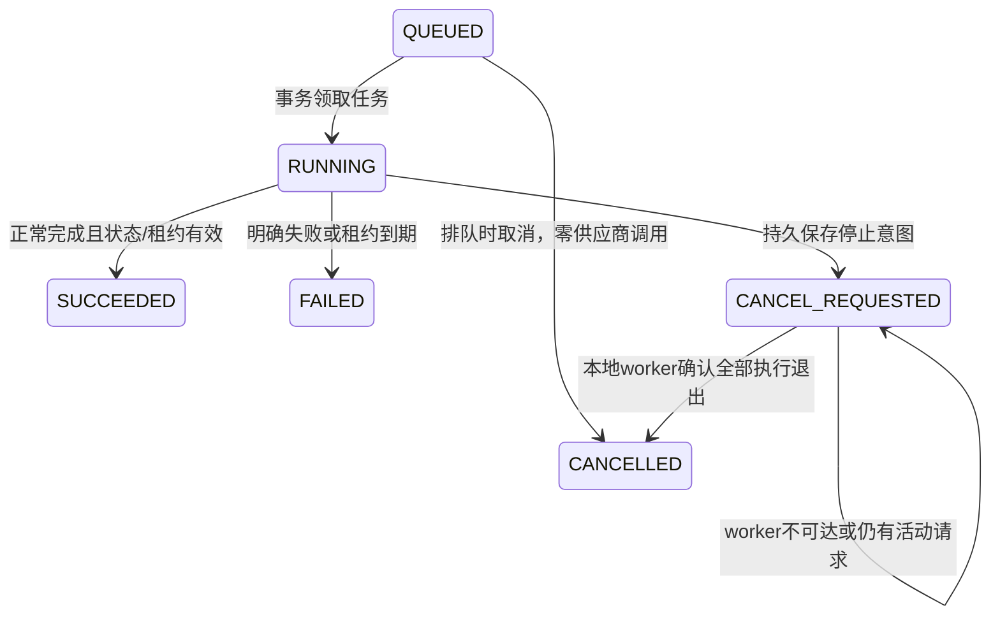

# LabLens 会话第二轮：可靠执行、取消与真实评测

日期：2026-10-29。起点 `075bf8d`，实现提交 `2e30611`。继续作为 v0.13 候选迭代，未发布新的正式版本。

**本轮交付结构化动作、执行预算分配和持久取消。回答质量仍未通过完整验收。** 工程测试、受控故障与真实模型答案分别统计；不能把能够执行、引用存在或检索命中写成回答准确。

## 背景与痛点

上一轮已有 MySQL 多轮会话、用户固定目标/限制、不可变资料快照与保守上下文预算。真实调用暴露了三个问题：供应商没有返回有效原生工具调用；检索、单独核验、提交、复核组成的长链路接近75秒预算；回答漏掉用户要求的比较项或实验范围。

另一个工程缺口是任务中断：关闭页面不等于取消后台任务，发出停止请求也不等于模型服务已经停止计费。本轮明确两种状态，并用真实 JVM/Python/MySQL/Redis 故障控制检验它们。

## 实现与设计

| 部分 | 本轮实现 | 边界 |
|---|---|---|
| 模型动作协议 | 工作区实时分支返回严格 JSON action，模型选择检索、重读、澄清或合并核验报告；本地再检查动作和参数 | 旧实验 Agent 保留原生工具协议；无错误后自动降级重发 |
| 合并核验 | `verify_and_submit_report` 先确定性核验全部已检索片段的原文、偏移及哈希，再做同模型复核；独立 `source_validation` 事件说明核验由服务端执行 | 不伪称另一次模型选工具；来源匹配不证明语义蕴含 |
| 上下文与预算 | Provider 上下文去掉重复原文；完整轨迹仍保存。预算检查使用真正发送的 schema/messages；75秒总预算不变，为复核预留最多20秒 | 保守字节估算，不是精确 tokenizer；在途请求可能使墙钟时间略超预算 |
| 用户范围 | 报告附带明确标注“用户提供、非证据”的目标/限制；当前更正优先；提示要求正文保留双方比较值与来源支持的样本范围 | 附录不计为模型遵守约束，也不把用户陈述升级为事实；实测仍有遗漏 |
| JVM / MySQL | Flyway V5 保存取消请求/确认时间；取消与新会话轮次串行化；待确认取消仍计入忙碌/容量；迟到完成不能覆盖取消 | 仅取消控制请求可重发，模型任务不自动重试 |
| Python | 共享 Event 在模型、工具及复核边界停止后续工作；内部 HTTP 检索继承父任务身份，并计入活动引用数 | 等父执行及内部检索都退出才确认；不强行中止供应商已收到的请求 |
| 用量与 UI | 已完成调用用量保留；未知计数为null。停止中、已取消、刷新历史和显式准备新任务可见 | 准备重试只填回请求，重新提交要新许可；不是恢复原执行步骤 |

Python 注册表只属于**单个本地进程**，最多10000个任务身份，保留完成/取消标记以阻止迟到重复执行；满时拒绝新任务，不能驱逐标记后悄悄重放。应在无活动任务时重启清空。这不是分布式任务协调，不能在多个 Python worker 间负载均衡后仍宣称取消保证成立。

## 验证与证据

| 验证 | 结果 | 证明范围 |
|---|---:|---|
| Python 全量 | 652 passed | 协议、预算、证据、取消传播及既有行为；离线测试 |
| JVM | 60 passed，其中34项真实MySQL/Redis集成 | 事务、幂等、状态、版本、取消及用量；未调用外部模型 |
| 前端 DOM | 38 passed | 重复点击、迟到响应、工作区隔离、停止中阻塞、新任务许可 |
| 最终实际 HTTP 故障 | 4场景 / 35检查全部通过 | 真JVM→Python→受控本地provider，外部调用0；不属于模型质量测试 |
| 实际 Chromium | 8项检查通过，390px无横向溢出 | 停止中→已取消、刷新后打开原记录、用量与新许可；一个受控案例 |
| 主服务升级 | V5成功，历史校验一致 | 原182任务、13工作区、42资料完整保留；迁移前本地备份 |

证据：[Python/前端](evaluations/conversation-round2/regressions.json)、[JVM](evaluations/conversation-round2/jvm-tests.json)、[最终故障](evaluations/conversation-round2/cancellation-fault-final/README.md)、[浏览器](evaluations/conversation-round2/browser/summary.json)、[迁移](evaluations/conversation-round2/main-migration.json)。Python仅有一条既有Starlette弃用提醒。实现提交的[GitHub CI](https://github.com/N7766/lablens-agent/actions/runs/40749252081)四个任务均通过，覆盖Python3.11/3.13、前端及真实服务集成。

四类故障分别验证：排队取消零调用；运行中停止、阻止同会话新请求与迟到发布；第一次嵌入完成后取消、不发送第二次嵌入并保留用量；JVM重启/worker不可达时继续保持待确认，worker重启确认后历史用量仍为未知。最初控制与最终控制分别保留，不覆盖旧结果。

交叉审查发现并修复了两个真实缺口：内部语义检索最初没有继承停止信号；普通RAG取消最初会丢掉已记录的用量。新增嵌套请求计数与完整取消结果封装后，针对性测试和最终HTTP控制均通过。浏览器控制发生在最后一次预算/提示调整前；最终后端故障控制使用冻结代码且 `source_unchanged=true`，不将两者混作同一次验收。

## 真实模型：开发回归

使用本地四服务和 DeepInfra `Qwen/Qwen3-235B-A22B-Instruct-2507`，BM25检索，逐任务最多6次决策+1次复核，无自动重试。以下题目在上一轮已曝光，因此全部是开发回归，不是新盲测。

| 独立保存的尝试 | 执行结果 | 语义结果 |
|---|---|---|
| 初版v3，单次决策上限30秒 | 3任务：1成功、2超时；3依赖轮阻断 | 成功答案遗漏基线比较/范围，严格0题通过 |
| 修正预算与通用提示后的主尝试 | 3任务：1成功、1启动连接失败、1超时；3依赖轮阻断 | HarborBridge首轮核心指标正确，但正文范围仍不完整；严格0题通过 |
| 确认worker健康后的CedarBend显式补测 | 3任务全部完成 | 2题严格通过，首轮仍遗漏基线比较及同条件范围 |

第二次主尝试中的连接失败是本次测试启动顺序错误：worker重启后未等待健康检查便提交，记录 `ConnectException`。原失败和保守未知用量保留；只显式重跑CedarBend，不重复HarborBridge，也没有改提示后再反复挑选成功答案。

按最终候选的六个题位汇总（HarborBridge主尝试+CedarBend显式补测），**2严格通过、2部分正确、1执行超时、1依赖阻断**。这是跨两次尝试的题位汇总，不能写成“单次6题跑通”或“整场景正确”。4份完成答案的必需文档均被检索到，必需文档出现次数6/6；错误拒答0/4完成且可回答题。没有答案的轮次，其语义、错误拒答与检索指标不能当作通过或直接按未检索计分。

评分检查完整结论、双方数值、指代、来源范围及必需证据，不只检查引文是否存在。用户范围附录不代替来源支持的结论。详细逐条判定与原始任务哈希见[开发复核](evaluations/conversation-round2/development-grading/review.json)。评分者参与了开发，明确属于AI开发复核。

## 新题一次性评测

由未参与本轮实现、未看旧题的AI代理预先冻结2个新场景、7份合成本地资料和6轮问题/评分规则。实现方在推理前未见新题；固定实现只运行一次，保存全部首次输出，再冻结评分。**这是隔离出题的AI评测，不是人工独立评测，也不是生产准确率。** 题目现在已经公开，今后只能作为曝光回归集。

| 指标 | 结果 | 口径 |
|---|---:|---|
| 执行完成 | 6/6 | 无重试、失败或依赖阻断 |
| 完整语义正确 | 4/6 | 检查数值、比较、矛盾和未知项 |
| 严格全项通过 | 3/6 | 同时满足语义、来源、指代/澄清及适用约束 |
| 必需检索覆盖 | 5/5 | 另1题应先澄清，检索轴不适用 |
| 结论与来源对应 | 3/6 | 引文真实存在也可能不支持当前结论 |
| 错误拒答控制 | 5/6 | 1题对本可回答的分项追加了无依据拒答 |
| 指代/澄清 | 5/6 | 1题直接列出两台机器，没有按要求澄清指代 |
| 未越出资料适用范围 | 6/6 | 不等于正文明确写出“合成本地”；后者仅1/6 |

三份未严格通过的报告分别暴露：`larch-t2`数值结论正确，但部分阈值判断没有同时引用阈值协议；`cedar-t1`正确发现汇总记录矛盾，却在最终复核新增了没有证据支持的分项拒答；`cedar-t3`面对含糊的“那台机器”未请求澄清，而且一条分项数值选用了汇总值的引文。前两类不能靠提高检索召回率解决，最后一类也不能因列出了两个正确数值便忽略冻结的交互要求。

精确引文34/34、引用对象15/15均存在，但严格来源轴仅3/6通过，直接说明“引用存在”不足以作为质量验收。6轮共20次模型调用（14次动作决策、6次复核），输入76905、输出4608，共81513 tokens；没有嵌入调用或未知用量。这是持久任务与轨迹核对后的用量，不是独立供应商账单。完成耗时中位数50.47秒、最大62.18秒；仅描述6个本地样本，不作p95或服务承诺。

完整[评测包](evaluations/conversation-round2/new-scenarios/README.md)、[逐题评分](evaluations/conversation-round2/new-scenarios/grading/per-turn.json)、[汇总](evaluations/conversation-round2/new-scenarios/grading/summary.json)和[范围措辞补充](evaluations/conversation-round2/new-scenarios/SCOPE-NOTE.md)均保留。输入清单SHA-256为`d9fcb153ffc87f581380635cb4df13ed8e5c67adec64d79408a56e2c4b9d88ce`；完整证据包清单为`eb78f2f2825c6a7bff4447fcf96247b22babcaa01e5bc9061b54f1a9da5ada6f`。6次执行的Agent代码指纹一致，推理期间资料未变化。

## 改进效果与仍需处理的问题

常规一次检索/报告链路可以使用2次动作决策+1次复核。不能据此声称所有任务都只需3次调用：模型仍可能选择额外检索或重读，且同模型复核本身也可能超时。CedarBend补测三轮各使用3次模型调用；HarborBridge首轮用了4次、约70.8秒，下一轮在最终复核时达到预算。

两个前后均完成的已曝光题，分别观察如下；样本很小、输出内容和质量并不等价，不作因果性能或p95结论。[逐任务对比](evaluations/conversation-round2/development-grading/matched-comparison.json)

| 同一道开发题 | 上轮→本轮模型调用 | 上轮→本轮输入token | 上轮→本轮耗时 |
|---|---:|---:|---:|
| cb1 | 4→3 | 19130→9902 | 61.42秒→31.19秒 |
| hb1 | 4→4 | 18070→15970 | 58.30秒→70.79秒 |

cb1的速度与输入量下降伴随基线比较遗漏；hb1反而更慢。因此不能把这些观测写成“保持质量的统一加速”。

本轮改为结构化动作并补齐本地解析校验，但没有消除推理、指代和完整性问题。下一轮优先把用户问题拆成可核对的回答义务（比较对象、指标、样本范围、未知项），让每条判断绑定支持它的具体片段，对歧义执行澄清，并防止复核新增无依据拒答；同时限制没有新证据收益的重复读取。改动后需重新冻结新题验证，不能只加提示后沿用已曝光题证明效果。

暂停、步骤检查点续跑、SSE重连、自动事实摘要、精确tokenizer和长期向量记忆仍未实现。取消和手动新任务是本轮中断处理的边界。语义质量尚不稳定时，不自动把模型结论写入长期事实记忆。

## 简历与面试使用

可写：

> 为Java/Python研究Agent实现持久多轮任务与协作式取消：MySQL保存资料快照、幂等请求及取消状态，Python将停止信号传播到嵌套检索，并通过活动请求计数、迟到写入保护和已知/未知用量账本保证中断可追溯；以真实MySQL/Redis集成及4类HTTP故障注入验证状态一致性。

可演示：提问→模型选择动作→检索→服务端来源核验→同模型复核→刷新历史；另一条受控链展示停止请求与真正停止的区别。面试应解释Redis不是持久队列、来源匹配不是结论正确、历史答案不是事实记忆，以及为何未知外部结果不能自动重发。

不宜写“生产级Agent”“支持无损断点续跑”“多轮准确率100%”“已完成长短期记忆系统”或把受控provider用量当真实模型费用。项目价值主要是可展示的后端状态管理、跨服务协调与可复核评测，不是已成熟的通用问答效果。
