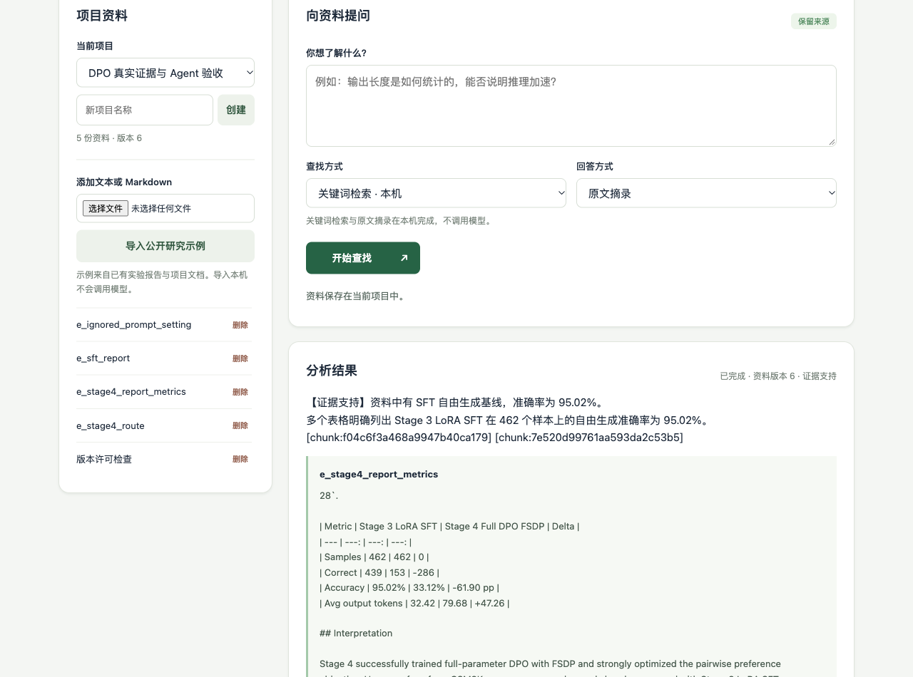

# 真实浏览器 Agent 连通验证

2026-10-28，headed Chromium/Playwright；真实Qwen模型、Python Agent、本机HTTP检索、Spring Boot、MySQL和Redis。BM25无embedding请求。完整原始任务JSON和源码/JAR哈希见`summary.json`及以下文件。

| 顺序 | 文件 | 观察 |
| --- | --- | --- |
| 1 | supported-task.json | QA工作区版本5，模型选择search→verify→submit，4次模型调用，正确给出SFT95.02%；刷新恢复来源、轨迹及哈希。 |
| 2 | missing-first-attempt.json | 零命中后模型调用空verify被协议拒绝，6次决策后明确budget_exceeded；保留失败。 |
| 3 | insufficient-final-task.json | 修复空核验协议后，同一p99问题4次调用完成，status=refused、agent.state=insufficient_evidence；JVM任务SUCCEEDED表示执行完成，不表示问题有答案。 |
| 4 | supported-final-task.json | 主工作区另一次SFT请求因75秒预算超时失败，3次尝试调用，provider用量未知；没有报告，未自动重试。 |
| 5 | supported-manual-retry.json | 点击“准备新任务重试”、重新许可后提交新任务；4次调用，正确给出462题上的SFT95.02%，刷新恢复版本6报告。 |

总计5次尝试，3次报告、2次失败，21次模型调用。两道开发问题跨实现/服务版本演示，不将3/5称为用户总体成功率；完整费用因一次超时用量未知不能求和成确定总值。未隐藏失败或无界重跑。

最终演示在`http://127.0.0.1:8081/`项目“DPO 真实证据与 Agent 验收”。首次两条保留在独立QA数据库及本目录JSON，不与主库混合；临时8083/8767服务与8766评测服务已停止。启动后执行依赖本机服务和有效API配置，截图不是永久在线托管承诺。

额外观察：

- 资料版本4时勾选许可，外部更新为5后提交得到409，任务列表仍空，许可自动清除；手动重新确认后才创建任务。
- 对缺证据完成任务，将当前资料从5改为6；前后GET旧任务JSON逐字相同，见`history-after-source-edit.json`。
- 重载浏览器后选择历史，报告、模型工具选择、资料哈希和旧版本均可查看。
- 390px视口最初scrollWidth501，修复CSS grid最小宽度和哈希换行后为390。移动端截图与1280px桌面截图已检查；未覆盖Safari或真实手机设备。

语义范围：SFT存在与95.02%在提供表格内；p99未生成虚构数值。零命中只说明本次检索没有获得证据，不能证明整个项目不存在该信息。第一次SFT说明重复了原表误名“output tokens”；本轮DPO案例已明确其实际为空白词数，不能将那句用作token测量结论。模型选择与同模型复核不等于独立语义验证。

原始JSON可能很长，因为保存了模型工具参数、检索内容、核验结果与报告；没有保存API认证头或密钥。浏览器自动化本身发生过相对URL、折叠状态和seed方法选择错误，已在summary区分记录，不当作产品请求成功。

[390px完整页面](v013-mobile-final.png)
