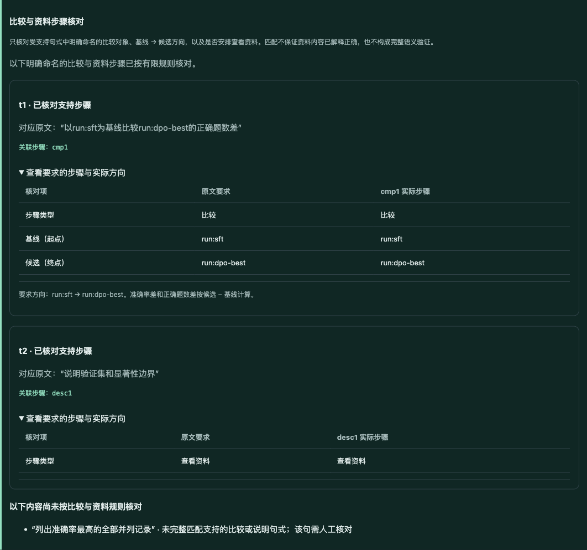
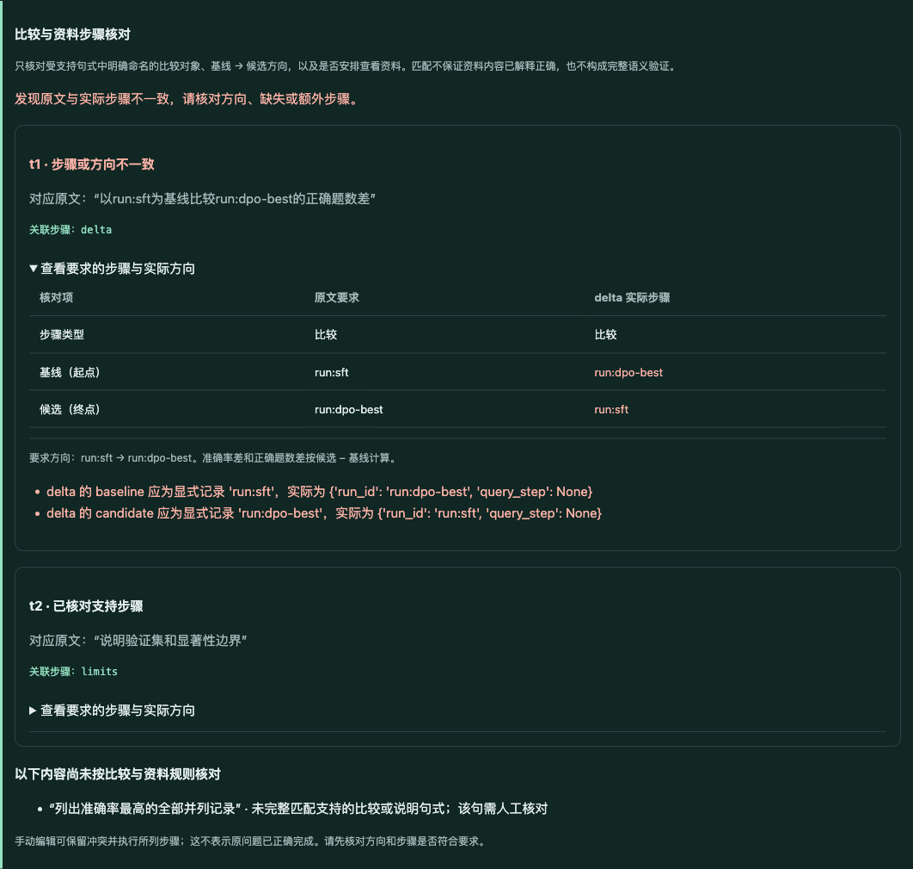

# v0.10：比较方向与资料步骤核对

2026-10-16。本轮把有限请求核对从查询条件扩展到明确命名的比较方向及资料操作。原文被引用、计划能够执行，都不能证明基线和候选没有写反，也不能证明资料要求没有被替换成其他操作。[五步计划](v0.10-plan.md) · [工作台说明](v0.10-workbench.md)。

**正常提问对照最终两组均12/12通过；新增检查没有显示成绩优势。**三个预声明人为错误在新规则反馈后均被一次真实请求修复，但这是独立的受控实验，不是自然错误恢复率。

## 核对的具体范围

- 完整匹配 `以run:X为基线比较run:Y的正确题数差/准确率差/平均长度减少比例`，两个ID必须存在于当前快照。核对实际操作、显式基线与候选方向，不将碰巧选出同一记录的查询引用当成明确ID请求。
- 完整匹配三类资料请求：`说明长度单位与数据来源`、`说明验证集和显著性边界`、`说明缺失字段与证据边界`。这里只检查安排了一个describe操作，**不证明展示的资料已经解释全部语义要求**。
- 错误操作、缺少步骤、重复步骤、部分/跨句引用或已支持任务被标记未处理，都不能算匹配。相同完整句子重复出现时保守标为无法唯一关联。
- 引用、否定、未知ID、指代和超出完整句式的表达保持未核对；不从字符串局部猜测意图。通用语义验证仍为 `not_performed`。
- 生成API默认启用。新核对与已有查询规则一起在计算前汇总冲突，反馈提供可修改的提案字段，并共享最多两次模型请求。启用新核对时错误摘要上限8,192字符，以容纳组合反馈；历史关闭路径保持1,800字符。供应商错误不自动重试，不静默改写提案。
- 预览及执行结果新增方向对照，生成过程展示逐次核对。手动计划可保留冲突执行所列步骤，但持续提示；收据格式保持兼容，重算仍不证明问题已正确完成。

## 数据、预声明与冻结

[六道新组合题](../evaluation/v0.10/cases.json) · [三个故障定义](../evaluation/v0.10/controls.json) · [评分范围](../evaluation/v0.10/rubric.md)。题目使用已有11条DPO真实验证集摘要和v0.9的8条Atlas合成记录，没有新增训练实验，也不是第二个真实项目。DPO的检查点选择、空格词数与显著性边界仍保留，Atlas继续标记synthetic。

每题包含查询、明确ID比较和资料说明。字面合同提前指定查询参数、成员、必要顺序、比较对象和三项差值、完整行值、当前原文说明及数据指纹；并列记录的数值相同也仍检查ID方向。题目由了解实现的助手编写，不属于独立人工保留集。

真实请求前固定提交 `82de2df5f2e7fefbcf6807e6d810baed2b90f5de` 的33个源码、数据与评分文件，保存v2提示/schema及实际注入消息的字节和哈希。运行使用冻结的题目、快照和错误种子，运行期间Python源码未改变；事后逐项对照冻结字节、工作区与提交一致。[自然测试manifest](evaluations/v0.10/natural/manifest.json) · [受控测试manifest](evaluations/v0.10/controls/manifest.json) · [来源审计](evaluations/v0.10/source-audit.json)。后续仅补充页面范围说明文字及交付文档。

DeepInfra `Qwen/Qwen3-235B-A22B-Instruct-2507`，temperature=0，max_tokens=2600，请求超时90秒，workers=2；后端revision不可见。开关两组的初始v2提示、schema、数据、查询检查和两次请求上限相同，差别为新增任务检查及其反馈路径。独立采样的小型对照不构成一般性因果或统计结论。

## 正常提问对照

6题 × 开关两组 × 各重复2次 = 24个draw，最多48次请求。未替换失败，也未追加抽样。首次成绩通过本地重放已返回的第一条模型消息计算，不额外请求或计费。

| 指标 | 关闭任务规则 | 开启任务规则 |
| --- | --- | --- |
| 首次合同通过 | 12/12 | 11/12 |
| 最终合同通过 | 12/12 | 12/12 |
| 真实请求 / 其中修正 | 12 / 0 | 13 / 1 |
| 新任务规则冲突 | 0（未启用） | 0 |
| 结果重算 | 12/12 | 12/12 |
| 提供方报告prompt / completion tokens | 57,248 / 1,818 | 63,188 / 1,955 |
| 提供方报告估计费用 | $0.00615222 | $0.00676217 |

24个最终结果全部通过合同，总25次请求，报告费用$0.01291439，无未知用量。费用不是结算账单；并发时间不作为受控性能基准。

唯一首次失败是 `task_rules_on-dpo-frontier-length-r2`：模型把比较错误关联到c1，导致c2遗漏，原有分句校验返回 `Unmapped clauses: c2`。第二次正确关联后通过。这个修正由**已有结构校验**触发，尚未进入新任务检查，不能归因于新增方向/资料规则。

[逐条结果与汇总](evaluations/v0.10/natural/summary.json) · [完整原始消息与首次失败](evaluations/v0.10/natural) · [第二位助手复核](evaluations/v0.10/natural/second-assistant-review.json)。两组最终同分，首次差异出现在独立采样，不能宣称新增规则提高了自然任务成功率。

## 人为错误的真实修正，单独计数

在调用前从预声明正确提案构造三个错误种子，并保存实际消息：反转比较对象、把资料操作替换成比较、重复比较。第一条消息由代码提供，**不是模型自然产生的错误，不消耗API请求**。新规则发现问题后，每例最多调用模型一次返回完整替换提案；模型收到问题、数据、错误提案和反馈，不收到正确参考提案。

| 预设错误 | 无新增检查的离线负例 | 一次真实修正后 |
| --- | --- | --- |
| 明确比较方向颠倒 | 可执行、合同失败 | 通过，方向恢复 |
| 资料步骤被比较操作替换 | 可执行、合同失败 | 通过，describe恢复 |
| 重复命名比较 | 可执行、合同失败 | 通过，多余比较移除 |

三个错误均被新规则识别，**3/3**在一次真实替换后通过，3份收据可重算。共3次真实请求，报告费用$0.00162919，无未知用量；轨迹中的6次规划接口完成包含3条免费种子，不能写成6次API调用。

[受控结果](evaluations/v0.10/controls/summary.json) · [种子、反馈与真实替换](evaluations/v0.10/controls) · [关闭检查的三个离线负例](evaluations/v0.10/offline-controls/negative-summary.json)。离线正例使用人工正确替换也为3/3，模型调用为0，单独保留。这证明特定错误的检测和反馈路径可用，不能推断自然出错频率或总体恢复率。

## 工程和浏览器验证

- **380项测试通过**，比v0.9增加69项，覆盖完整句式与保守跳过、部分/跨句/重复关联、明确方向、资料操作、组合错误和共享预算、API默认启用、冻结消息、计费计数及合同反例。
- 83份v0.5–v0.9历史计划收据继续可重算，包括v0.9两份合同失败但内部一致的结果。离线参考计划6题两组共12份通过，0次模型调用。
- [17项模拟页面检查](evaluations/v0.10/browser/mocked-ui-checks.json)覆盖显示、失败候选、文本安全、输入失效和390px布局；模拟界面响应不计入模型成绩。
- 新服务上的真实浏览器完成离线示例、手动反转方向、带冲突执行和下载复核。反转后实际得到−3题，仍可重算；页面明确提示方向冲突，截图中的错误是人为修改。
- 另一次真实页面生成使用内置DPO和最高准确率查询，明确sft→dpo-best比较为+3题，两项任务检查匹配；手动执行、下载和上传复核通过。一次模型请求、报告费用$0.00059284，单列而不计入上述样本。浏览器无控制台错误/警告，390px无页面水平溢出。

[页面轨迹、结果与检查记录](evaluations/v0.10/browser)。全轮合计29次真实请求，报告估计费用 **$0.01513642**。两个评测复核文件均披露：助手参与了评测实现、知道开关标签，虽另行重算而不调用原评分器，仍不是独立人工或独立作者审核。





## 复现与边界

```bash
pytest -q
# 离线参考计划与人为正确替换，均不调用模型
python scripts/evaluate_tasks.py --repeats 1
python scripts/evaluate_tasks.py --suite controls
# 自然对照：24个draw，最多48次真实请求
python scripts/evaluate_tasks.py --live --repeats 2 --workers 2
# 单列故障注入：最多3次真实替换请求
python scripts/evaluate_tasks.py --suite controls --live --workers 2
lablens verify docs/evaluations/v0.10/browser/live-receipt.json
```

当前仅支持有限显式句式，不解决任意自然语言、多句指代、复杂查询依赖的完整性证明，也不证明资料内容回应了所有问题。应优先引入独立人工题目与审核、第二个真实实验项目和不受支持表达的案例，再判断是否扩大规则或采用其他验证方法。[Issue 10](https://github.com/N7766/lablens-agent/issues/10)继续开放。应用仍为本地单用户研究原型，无生产部署或公网用户隔离证据。
