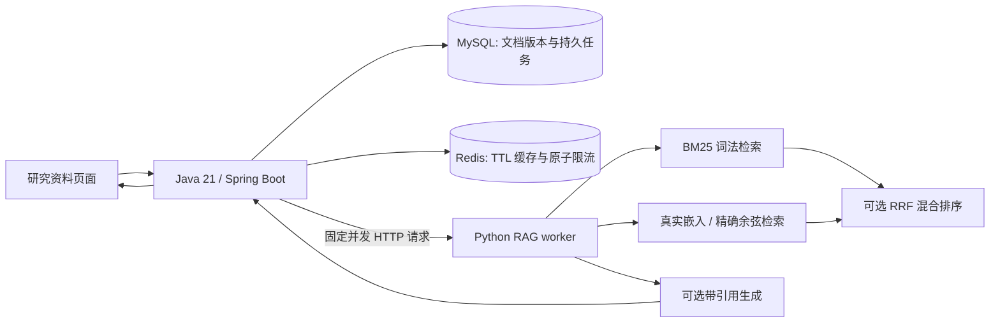

# 持久研究工作区

v0.12 增加一条完整的研究资料处理流程：创建项目 → 导入文本/Markdown → 保存文档版本 → 提交异步检索/回答任务 → 查看结果、引用、调用用量与历史。

## 职责分工



MySQL 保存任务状态和不可变输入快照，Redis 只提供缓存与限流。缓存故障不会移除数据库中的幂等保证。Java 使用有界平台线程池；JVM 指标由 Micrometer 暴露，没有宣称使用 JVM 字节码优化或分布式全局并发限制。

## 启动

Python-only 的旧工作台仍可以按照主 README 启动。完整工作区需要 Java 21+、MySQL 和 Redis。

### Docker Compose

复制 `.env.example` 为 `.env`，在本机填写两个数据库密码。纯 BM25 + 原文摘录不需要模型密钥；语义检索需嵌入配置，生成模式另需 LLM 配置。

```sh
docker compose up --build -d
```

- 工作区：<http://127.0.0.1:8081/>
- 旧实验工作台：<http://127.0.0.1:8765/>
- 指标：<http://127.0.0.1:8081/actuator/prometheus>

MySQL 和 Redis 使用命名卷。`docker compose down` 保留卷；不要为了常规停止添加 `-v`，那会删除数据。所有主机端口仅发布到回环地址。

本轮本机没有 Docker，实际验收使用原生 Java 24（编译目标21）、MySQL 9.5、Redis 8.2.2 和 Python 3.13。Compose 文件提供复现配置，容器启动状态见验收记录，不冒充本机已经运行过容器。

### 原生服务

MySQL 创建独立 `lablens_workspace` 数据库和仅对该库有权限的本地用户；准备 Redis。服务配置示例见 [JVM 服务说明](../services/workspace/README.md)。密码通过环境设置。

```sh
uv sync --locked --extra dev
uv run uvicorn lablens.api:app --host 127.0.0.1 --port 8765
# 另一个终端，先设置 JVM 服务说明中的 DB/Redis 环境变量：
mvn -f services/workspace/pom.xml verify
java -jar services/workspace/target/lablens-workspace-0.12.0.jar
```

网页可以一键导入本仓库公开的 27 份示例资料。自己的 `.md`/`.txt` 文件只在导入时保存本机；选择需要模型的模式时，页面会说明发送内容与费用并要求勾选。

## 关键行为

- 每份文档最多20,000个Java字符单位，每项目100份文档、合计200,000个字符；旧实验 JSON 导入限制不变。
- 同一项目中，同幂等键、同请求返回同任务；不同请求复用该键返回409。不同键明确表示新任务。
- 文档更新或删除改变项目版本，新任务绑定新快照，历史任务仍保留提交时的内容；删除当前文档不等于删除历史档案。
- 任务有 `QUEUED / RUNNING / SUCCEEDED / FAILED` 状态。排队任务可在重启后执行；运行中任务租约过期会失败，不自动重复可能已计费的请求。
- 已确认的 HTTP 错误保存安全的部分用量。中断无法确认供应商结果时标为未知；包括会调用嵌入的摘录模式。
- Redis 缓存命中后，本次 `execution_usage` 为0；原始结果的用量放入 `origin_usage`，避免重复计算费用。更换模型、模型修订或检索实现后必须更新 `LABLENS_CACHE_NAMESPACE`。
- 默认最多2个活跃worker、每项目200个待处理任务、每分钟120个新请求。Redis不可用时限流降级放行，状态页会显示；数据库队列容量仍生效。

## RAG 的范围

分块为800字符、重叠120字符，保留原文偏移与内容哈希。BM25 为词法基线；dense 使用真实嵌入模型并做精确余弦扫描；hybrid 使用 RRF（k=60）合并排名。这里是有界内存向量缓存和请求内索引，没有独立持久向量数据库。

“原文摘录”只展示检索候选，不承诺资料已经回答问题。“模型整理”检查结构、引用ID和来源对应关系，语义是否由引用支持仍需判断。无模型配置时返回不可用，不生成假向量或伪造回答。

`RAG_TOTAL_SECONDS=80` 控制是否继续发起后续供应商请求；各次 I/O 超时不超过剩余预算。HTTP 超时无法撤销供应商已经开始的计算或费用，不能承诺硬性取消远端执行。

项目持久化不等于跨会话长期记忆。现有工具调用 Agent 和确定性实验分析仍可独立使用；本轮不包含身份认证、MCP、大规模索引或线上用户验证。

## 复测

```sh
pytest -q
LABLENS_INTEGRATION_TESTS=true mvn -f services/workspace/pom.xml verify
python scripts/evaluate_workspace_system.py --output reports/workspace-system
# 以下两条使用真实嵌入/生成，会产生调用费用：
python scripts/evaluate_workspace_rag.py --output reports/workspace-rag
python scripts/evaluate_workspace_rag.py --strategies hybrid --live-generation --live-limit 4 --output reports/workspace-live
```

真实故障控制另见 [故障记录](evaluations/v0.12/faults/README.md)。运行脚本前按该文件准备独立测试数据库与专属端口，不要对个人正在使用的数据库进程做故障注入。
