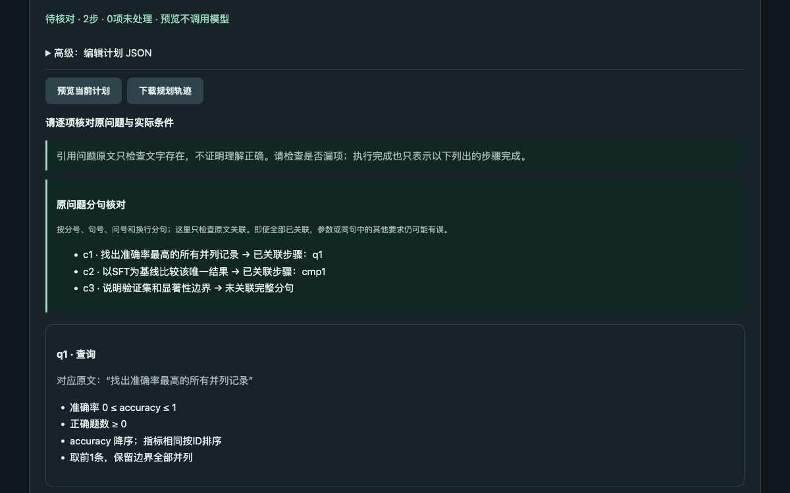
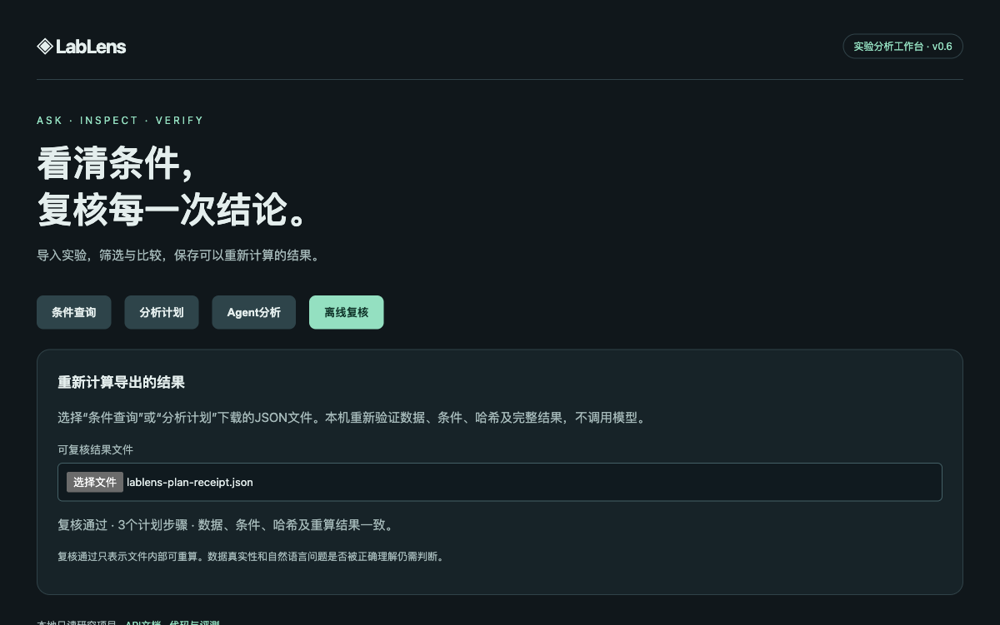

# v0.6：显式规划选项与调用预算对照

2026-10-16，DeepInfra `Qwen/Qwen3-235B-A22B-Instruct-2507`。本轮将查询排序、top-k和并列处理改为明确选项，加入原问题分句关联与最多一次本地校验修正。新规划格式减少了本组结构失败，但仍有可执行的语义错误。网页继续要求核对参数。

## 设计与冻结

- [实现说明](v0.6-workbench.md)、[三阶段计划](v0.6-plan.md)。最终运行源码提交为`cf3b477a7d752438e40246d486da2e41aa68308d`。
- [题集](../evaluation/benchmark-v0.6.json)含4道新的混合组合题，每组重复2次，共24次。旧v0.5题用作开发回归；仍使用相同11条实验和6条说明，概念重叠，不是外部独立测试集。
- [冻结manifest](evaluations/v0.6/holdout/manifest.json)保存提示词、配置及23个源文件/数据/题集/rubric哈希；[frozen-source](evaluations/v0.6/holdout/frozen-source)保存对应字节。查看保留题结果后没有调整运行代码、提示词或题集。
- temperature=0、max_tokens=2600、单请求超时90秒、workers=4。供应商未公开后端模型revision；温度0仍不能保证重复相同。
- 旧`planner`最多1次，新`guided_once`最多1次，新`guided`最多2次。新两组提示词和动作格式相同，分别独立调用，不是将单次组失败接着修正。旧新提示词/结构不同；三组均提前读取内置摘要与说明，使用同一计算和呈现层。
- 脚本在预览后自动执行，明确标记`unreviewed_evaluation`；这是评测，不是用户已批准计划。按冻结rubric检查实际筛选条件、完整集合、比较方向、相关说明及矛盾未处理项。评分人是Codex助手，没有独立人工审核，原始`manual_*`保持null。

## 完整任务与执行状态分开统计

| 方案 | 完整任务 | 可执行计划 | completed / partial / invalid | 模型调用总数 | 模型耗时中位数 | 供应商报告估计费用合计 |
| --- | --- | --- | --- | --- | --- | --- |
| 旧单次planner | 0/8 | 3/8 | 1 / 2 / 5 | 8 | 7.080秒 | $0.00537514 |
| 新单次guided_once | 7/8 | 8/8 | 8 / 0 / 0 | 8 | 5.720秒 | $0.00505124 |
| 新两次预算guided | 6/8 | 8/8 | 8 / 0 / 0 | 8 | 5.634秒 | $0.00508809 |

**这24条都只请求了一次模型，新两次预算组没有触发修正。7/8与6/8的差别不能解释为修正收益或退步。**本轮只说明新结构在这个小样本更容易得到可执行计划；不支持通用成功率、统计优势或生产可靠性结论。

全部用量均有返回，没有超时/未知用量。三组合计报告估计费用$0.01551447，不含开发回归与浏览器冒烟，也不作为结算账单。并发请求下的耗时不能当作受控延迟基准。三组实际执行7、26、27个计划步骤；`tool_calls=0`表示没有Agent工具循环调用，不代表模型之后没有计算。

[summary](evaluations/v0.6/holdout/summary.json) · [助手逐条评分](evaluations/v0.6/holdout/assistant-review.json) · [可重算汇总](evaluations/v0.6/holdout/aggregate.json) · [receipt诊断](evaluations/v0.6/holdout/diagnostics.json) · [全部24条轨迹及源码](evaluations/v0.6/holdout)。19份可执行结果的receipt均重算一致；5个无效计划无receipt。该诊断不验证问题意图。

## 成功与失败如何判定

前3题的新两组共12条均按要求交付：长度<31.6后的准确率最小值10及best→10；正确数≥438且准确率≤95.2%的最长sft及sft→09；严格优于SFT两个条件后的长度前2条02/best及03→02。相关显著性、种子/费用缺失和词数单位说明齐全。

第4题把两个查询写在同一分句：正确数≥440的完整Pareto集合应为best/02，正确数≥443的所有记录应为空，另有best→02比较与峰值显存说明。

- 新单次r1：把Pareto设为top1，只返回best，遗漏02。r2的两查询、比较及缺失字段说明完整，通过。
- 新两次预算r2：把Pareto设为correct升序top1，只返回02，遗漏best；“所有记录”也误设top1。
- 新两次预算r1：q3给齐Pareto集合，q1额外返回非Pareto集合含03；但q2仍将“所有记录”写成top1。当前快照是空集，返回值碰巧相同；冻结rubric要求实际条件正确，因此仍判失败。此条不是因额外表格单独扣分，也没有把正确的Pareto表判成缺失。

这3条新规划失败都通过了分句关联和结构校验，因此不会触发本地修正。**分句关联不能验证同句多个要求或排序意图，receipt一致也不能弥补错误参数。**该限制继续由[Issue 10](https://github.com/N7766/lablens-agent/issues/10)跟踪。

旧规划器的4条极值题将top_k留空，后续唯一引用面对5条记录而被拒绝；另1条使用非法reason枚举。余下3条虽可执行：严格高于SFT被写成≥而返回02/04；两个partial计划遗漏比较和显存说明，完整任务均不通过。全部保留，不补跑替换。

## 开发回归与修正分支

[dev-before](evaluations/v0.6/dev-before)与[dev-after](evaluations/v0.6/dev-after)分别使用4道旧v0.5题各跑1次，助手评分3/4和4/4，不能当作新保留题成绩。两轮分别6次、5次模型调用，费用$0.00382862和$0.00317571；原始错误与各自源码字节都保存。

首轮编译器要求查询引用带`step:`前缀，模型返回裸`q1`后被拒绝；一次修正竟猜成错误实验ID，查询结果10却比较09→04。编译器随后支持无歧义的前置查询动作ID，未知/未来/非查询引用仍拒绝；不猜测实验ID。开发复跑4/4完整，但不足以证明引用和语义问题普遍解决。

修正机制另有确定性工程测试：一轮校验错误反馈后成功、重复无效输出停止、单次预算、协议损坏停止、供应商错误不自动重试，以及第二次失败不能返回第一轮过期候选。

## 工程与浏览器验证

159项pytest测试通过；包括显式四选项、原文偏移/小数分句、同句矛盾、缺漏分句、查询依赖、API默认路径、错误预算，以及“所有句子已关联但选错maximum”的反例。v0.5公开的6份可执行计划receipt在新代码上重算通过。

Playwright使用真实本地页面完成1次单独的模型生成：最高准确率best、SFT→best与方法说明3步，实际1次调用，保存[原始轨迹](evaluations/v0.6/browser/guided-smoke.json)。执行后下载[receipt](evaluations/v0.6/browser/receipt.json)，在离线复核页上传，显示3步重算一致。这次只作UI冒烟，不加入24条评测成绩。

删除describe步骤并重新预览，第三分句显示未关联；修改问题立即清除预览及执行入口。另检查390px手机宽度与桌面布局；控制台无错误。截图见下方。





## 复现

```bash
pytest -q
# 产生模型调用费用，运行后再独立审核新轨迹：
python scripts/evaluate.py --cases evaluation/benchmark-v0.6.json --split holdout --limit 4 --strategy planning --repeats 2 --workers 4
# 仅重算公开记录的指标与receipt，不调用模型：
python scripts/report_metrics.py docs/evaluations/v0.6/holdout
python scripts/audit_traces.py docs/evaluations/v0.6/holdout
lablens verify docs/evaluations/v0.6/browser/receipt.json
```

下一步应围绕明确错误建设“全部/极值/top-k”的请求核对和更多数据快照，再进行独立人工评分。此次没有声称完成通用语义校验，也未扩展到公网多用户部署。
