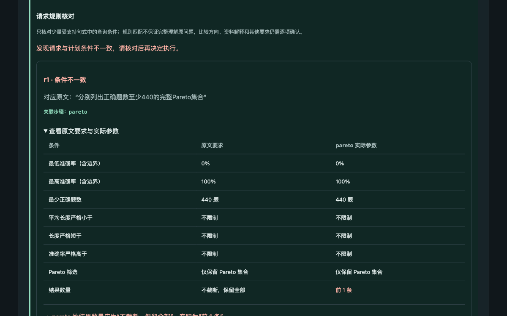
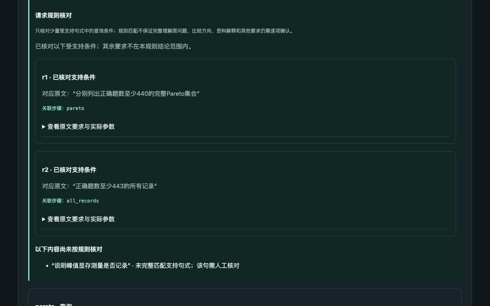

# v0.7：有限请求规则、同预算对照与受控修正

2026-10-16。本轮给少量明确中文查询句式增加独立于模型输出的参数核对，针对“完整集合被top1截断”“排序指标错误”等已知问题。未知表达明确未核对；不把有限规则推广为完整语义验证。[使用与范围](v0.7-workbench.md) · [本轮计划](v0.7-plan.md)。

## 实现与边界

规则完整匹配“列出/查询/找出”开头的全部记录、完整Pareto、全部并列极值、带边界并列的top-k；支持正确题数、准确率上下限与严格长度上限的有限组合。只在完整匹配后提出预期参数，按每个请求的筛选范围和Pareto标志关联查询，再检查编译后的排序与截断。空集或单行结果不能掩盖错误参数。

“最高准确率的所有并列记录”合法使用top1；“所有记录”要求不截断，两者不会因同含“所有”而混淆。同句只支持明确的“，以及”分隔；未知连接、未消费限定条件、否定、同范围无法唯一关联等会未核对。含引用标记的整题保守未核对，避免把跨分号/换行的示例当指令。部分原文引用的额外查询会进入冲突诊断。

自动生成在结构、引用、计算预览之后核对规则，明确冲突可使用现有一次完整修正预算。手动编辑仍可选择执行列出的部分步骤，预览与结果均保留冲突提示。receipt格式不变，旧文件只检查原计划重算一致性。

## 新题对照：24次独立运行

- 冻结代码提交：`90470a8`。模型：DeepInfra `Qwen/Qwen3-235B-A22B-Instruct-2507`；temperature=0，max_tokens=2600，单请求超时90秒，workers=4。供应商后端revision不可见，温度0不保证重复一致。
- [新6题](../evaluation/benchmark-v0.7.json)各组重复2次，旧`guided`与新`checked`均最多2次请求，使用相同提示词、动作格式、内置摘要和呈现。唯一策略差别是是否把新增规则冲突反馈给模型。两组是独立抽样，不是配对的相同首轮回复。
- 4题包含受支持句式，2题是含否定/不支持同义词的语言对照。旧v0.6题改为开发回归。仍是同一11条摘要、6条说明的组合，不是外部独立数据。
- [manifest](evaluations/v0.7/holdout/manifest.json)和[frozen-source](evaluations/v0.7/holdout/frozen-source)保留24个源文件/数据/题集/rubric的哈希及字节。读取结果后未改变评测运行代码、提示词或题集；后续仅完善页面中文文案、报告与单独的受控重放脚本。

| 方案 | 首轮完整任务 | 最终完整任务 | 可执行计划 | 模型请求 | 修正请求/成功 | 耗时中位数 | 报告估计费用 |
| --- | --- | --- | --- | --- | --- | --- | --- |
| guided（原流程） | 9/12 | 9/12 | 11/12 | 13 | 1 / 0 | 10.182秒 | $0.00820353 |
| checked（加规则） | 11/12 | 11/12 | 11/12 | 13 | 1 / 0 | 11.243秒 | $0.00817218 |

**这批新题没有触发新增请求规则的冲突反馈，9/12与11/12不能归因于规则修正收益。**两个修正都来自已有的错误引用校验，且修正失败。新组首轮恰好没有出现对应的排序/截断错误，不能把独立抽样差异当成因果效果或统计优势。

全部用量有返回，没有超时或未知费用；表中是供应商报告估计值，不是结算账单。并发下的耗时不是受控延迟基准。两组实际执行36/35个计划步骤，`tool_calls=0`只表示不运行Agent工具循环，不代表没有确定性计算。

结果由主助手核对，并由第二位Codex助手逐条复核；**不是独立人工评审**，`manual_*`仍为空。自动执行标为`unreviewed_evaluation`，不冒充用户核对。22份可执行结果均通过内部重算，2份无效计划没有receipt。

[逐条评分](evaluations/v0.7/holdout/assistant-review.json) · [第二位助手复核](evaluations/v0.7/holdout/second-assistant-review.json) · [汇总](evaluations/v0.7/holdout/aggregate.json) · [receipt诊断](evaluations/v0.7/holdout/diagnostics.json) · [完整轨迹](evaluations/v0.7/holdout)。

## 必须保留的失败

- 两组`bounded-top-three-r1`都把查询步骤ID `q1`填入需要实际实验ID的`more_accurate_than_baseline`，修正后原样重复，最终`validation_stalled`。这里的查询筛选基线不接受步骤引用；没有执行结果。
- `guided-pareto-and-singleton-r1`将Pareto查询设为maximum，尽管提案top_k=null，编译后仍为top1，只返回best、遗漏02。额外的非Pareto全量表不能补足请求。
- `guided-bounded-top-three-r2`用correct升序代替mean_length升序，返回04/06/08/sft，要求应是02/04/06。
- 两个超出规则范围的语言控制题在两组各2次均正确交付；它们被标未核对，没有因规则未识别而自动通过评分。

## 单独实验：重放错误后让真实模型修正一次

在观察上述结果后，选择旧组的两条语义错误首轮回复，原样重放，再给真实模型一次新请求接收本地规则反馈。**这是事后选择的受控修正实验，不是新的独立保留题，不计入9/12或11/12。**起点回复的源文件哈希、重放/真实来源和用量分别保存。

| 选择的旧回复 | 真实修正结果 |
| --- | --- |
| Pareto被maximum/top1截断 | 删除了额外查询，但保留maximum；编译后仍top1。第二轮规则再次拒绝，invalid_plan，无执行。 |
| top3排序指标为correct | 改为mean_length，返回02/04/06，比较08→best正确数+3、显著性说明齐全，完整交付。 |

两例各重放1条回复、各产生1次真实请求，仅**1/2修正成功**，另一条错误被阻止作为有效草稿返回。重放用量标零且不再次计费，两个新请求报告估计费用合计$0.00134071。`model_calls=2`在此表示1次重放+1次真实调用，真实请求由`live_model_requests=1`明确记录。不能据此宣称一般修正成功率。

[受控轨迹与冻结源文件](evaluations/v0.7/controlled-repair) · [评分](evaluations/v0.7/controlled-repair/assistant-review.json) · [可复现脚本](../scripts/replay_rule_feedback.py)。脚本复跑会产生费用，仍属于相同失败起点的受控实验。

## 历史回放、开发回归与工程验证

- [历史错误回放](evaluations/v0.7/historical-replay.json)：对v0.6已公开的3条截断错误及1条正确计划作确定性检查，三条报冲突，正确计划无冲突；没有模型调用，不算新题效果。
- [开发回归](evaluations/v0.7/dev)：旧v0.6四题各1次，4/4完整交付、4次模型请求、无修正，报告估计费用$0.00252947。其中3题不匹配语法而未核对，只有双查询题进入规则。
- **209项pytest测试通过**。新增50项覆盖四类过滤、全量/极值/top-k、同句独立绑定、截断在空/单/多行下仍报错、引用跨分句、局部引句额外查询、一次修正/重复失败/超时后不返回过期结果，以及25份v0.5/v0.6旧receipt兼容。
- 百分数解析使用Decimal转为float，防止94.5%与0.945因直接浮点乘法误报冲突。浏览器不把None/布尔/指标名直接作为冲突说明，而显示中文参数对照。

## 页面验证

Playwright在真实本地页面完成离线规则示例、将两个查询改为top1后显示冲突、恢复示例与真实模型生成（单独1次请求，不计入评测）。生成3步计划，Pareto为02/best、第二查询空集，下载[原始轨迹](evaluations/v0.7/browser/guided-smoke.json)及[receipt](evaluations/v0.7/browser/receipt.json)，在离线复核页重新上传并通过重算。

修改问题使预览失效；手机390px与桌面布局检查通过，控制台无错误。冲突提示不会声称已完成原问题，未核对内容始终单列。





## 复现与后续

```bash
pytest -q
# 真实模型调用，会产生费用：
python scripts/evaluate.py --cases evaluation/benchmark-v0.7.json --split holdout --limit 6 --strategy request_rules --repeats 2 --workers 4
# 下列只重算公开指标与receipt：
python scripts/report_metrics.py docs/evaluations/v0.7/holdout
python scripts/audit_traces.py docs/evaluations/v0.7/holdout
lablens verify docs/evaluations/v0.7/browser/receipt.json
```

[Issue 10](https://github.com/N7766/lablens-agent/issues/10)继续开放：规则不理解任意同义表达、跨句指代、复杂条件，也不核对全部比较和说明需求。后续应扩展数据快照、加入独立人工评分，并针对新的失败建立分离的开发/保留任务。本轮不声称生产就绪或公网多用户能力。
