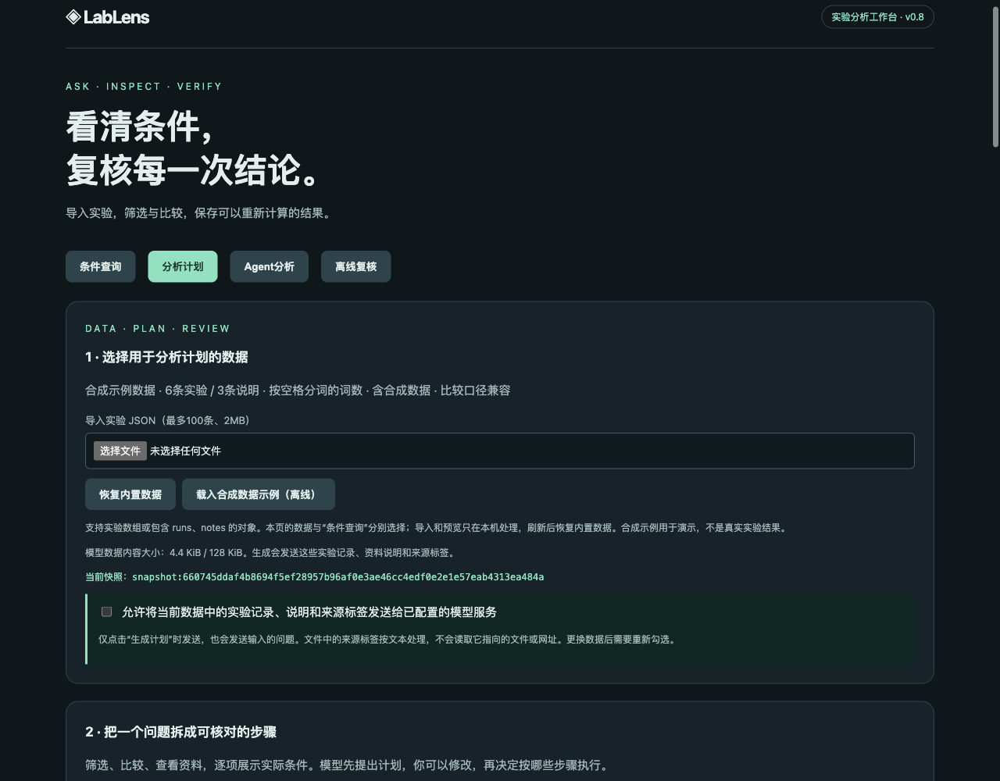
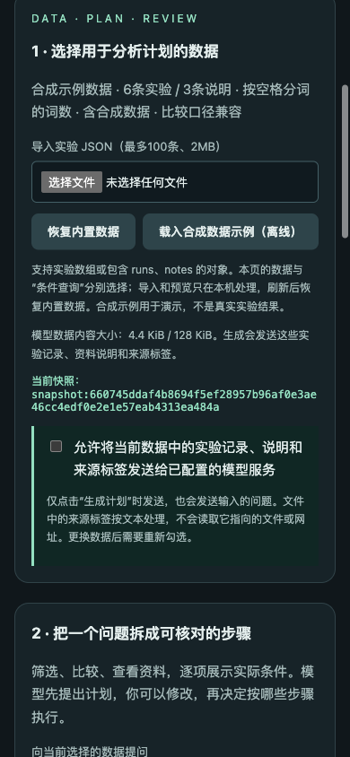

# v0.8：导入数据规划与跨快照验证

2026-10-16。本轮把模型规划从固定DPO数据扩展到用户选择的实验快照：同一份规范化副本贯穿模型输入与预览，执行继续绑定问题、计划和数据。页面新增独立导入、当前快照的发送选择和数据切换失效处理。[五步计划](v0.8-plan.md) · [使用说明](v0.8-workbench.md)。

**真实运行12次，8次通过预声明合同，4次完整Pareto失败被规则拦下。**这不是通用成功率，也不与v0.7分数比较：本轮使用不同的合成数据，检查的是新接口与明确的任务合同。

## 已实现

- `draft_guided(..., dataset=...)`使用请求内数据副本。轨迹记录`input_dataset`和`snapshot_id`；即使调用方在等待期间修改原对象，也不会改变本次模型输入及预览。
- `/api/plan/context`只在本地检查数据，返回单位、条目、快照和模型数据正文大小。导入数据生成需要`approved_snapshot_id`与当前快照一致，校验先于模型客户端构造。它是明确发送选择，不是用户鉴权或数据来源认证。
- 模型数据正文上限128 KiB，按UTF-8紧凑JSON计算；问题、工具格式和系统提示不计入这个数据正文限额。超限仍可手动预览与执行，不自动截断资料。
- 页面更换数据立即清除发送选择、旧草稿、预览及结果；迟到的旧请求不能覆盖新数据。错误导入使数据不可用，必须重新选择；不会静默沿用上一个快照。条件查询与分析计划分别选择数据。
- “平均长度严格小于…词”在tokenizer token数据上明确未核对，不把两种单位混为一谈。无单位的最高/最短等排序仍能检查。筛选基线字段明确要求当前快照的实际实验ID，不接受查询步骤ID。

## 数据与冻结判据

[题目与预期结果](../evaluation/v0.8/cases.json) · [评分范围](../evaluation/v0.8/rubric.md) · [合成输入](../evaluation/v0.8/fixtures)。

A/B各6条记录，使用相同`run:sample-a`至`run:sample-f`，但每条数值改变；同样问题的前两名边界并列、Pareto成员和比较差值随数据变化。A的sample-a→sample-c正确数差为+10，B为−10。C有4条记录，使用声明的合成tokenizer计数约定和独立ID。所有`synthetic=true`，来源哈希对应明确记录人工设定数值的JSON，**没有实际训练、模型测量或真实分词器运行**。

每份快照两题，包含查询、明确ID比较、原文单位/来源说明，共6题。合同在调用前写定：检查查询参数（空结果也不例外）、成员、必要顺序、比较方向和差值、完整记录值、当前原文说明及快照绑定。参数没有要求排序时不额外强加顺序。合同分数与receipt重算分开报告；`manual_task_success`仍为空。

调用前冻结提交`9f784178ee44305b6fa13f1ad8b741bab19f702f`的32个源文件、数据、脚本与合同。每个运行读取冻结的快照字节；运行后核对所有哈希、字节与工作区/该提交一致。[manifest](evaluations/v0.8/holdout/manifest.json) · [冻结源码](evaluations/v0.8/holdout/frozen-source) · [来源审计](evaluations/v0.8/source-audit.json)。

## 真实模型结果

DeepInfra `Qwen/Qwen3-235B-A22B-Instruct-2507`，temperature=0，max_tokens=2600，每请求超时90秒；后端revision不可见。6题各两次，workers=4，每次最多2个请求，供应商异常不自动重试。未替换重跑任何失败。

| 快照与任务 | 合同通过 | 真实请求 | 结果 |
| --- | --- | --- | --- |
| A：准确率前2条及边界并列 | 2/2 | 2 | b/c/d，比较+10题 |
| A：完整Pareto | 0/2 | 4 | 两轮后仍截断，未执行 |
| B：相同排序题、改变数值 | 2/2 | 2 | d/e/f，比较−10题 |
| B：完整Pareto | 0/2 | 4 | 两轮后仍截断，未执行 |
| C：长度严格小于250个token | 2/2 | 2 | token-b/token-c，比较+4题 |
| C：准确率至少90%的全部记录 | 2/2 | 2 | 空集，保留不截断参数；比较−2题 |

合计**8/12**通过；8份可执行结果全部重算通过，4条失败没有执行结果。16次模型请求，4次修正均失败；报告prompt tokens 48,966、completion tokens 2,162，供应商报告估计费用**$0.00559604**，无未知用量。耗时中位数8.8385秒，并发条件下不作为受控性能基准。费用不是结算账单。

C的token阈值句式不在当前有限中文规则内，显示未核对；它通过的是事先写定的合同，不能说有限规则已理解该表达。各题的比较/资料说明同样未获通用语义核对。

[汇总与逐条判定](evaluations/v0.8/holdout/summary.json) · [全部原始消息与失败](evaluations/v0.8/holdout)。另有[第二位助手逐条复核](evaluations/v0.8/holdout/second-assistant-review.json)，不是独立人工审核。

## 四条失败说明什么

`a-pareto-r1/r2`和`b-pareto-r1/r2`都把完整Pareto设为`ranking=maximum, top_k=null`。编译器对极值强制取第一名，所以实际`top_k=1`；规则明确报错。第二轮模型原样重复提案，状态为`validation_stalled`，预算到此结束。

预期A的Pareto成员为b/d/e，B为d/f/a/b；没有把被截断集合交付成有效草稿，也没有默默替模型改写计划。**检测有效不等于修正成功。**新数据支持没有解决已有的Pareto动作表达问题，后续应针对模型动作格式和可操作的修正反馈改进。

失败轨迹的合同诊断还包括缺少preview/receipt对应的指纹检查未通过；这是失败后没有产物，不能解释为实际串用了其他快照。没有可执行错误结果被当作正确结果计分。

## 工程与页面验证

- **247项测试通过**，新增38项覆盖数据副本、并发同ID隔离、原输入被修改、发送选择/预览随数值或说明变化失效、128 KiB精确边界、无效输入不构造模型、单位未核对、预声明合同反例等。47份v0.5–v0.7历史计划receipt仍能重算。
- [离线参考计划](evaluations/v0.8/offline-oracle)6/6合同通过、6/6重算、0模型调用；这是工程验证，未算入真实模型成绩。期望成员与差值为预先写定值，未从待测工具结果生成答案。
- 真实浏览器完成合成示例预览/执行/下载/上传复核；实际上传另一份同ID数据、无效文件、恢复内置示例、390px页面无横向溢出。
- 异步切换测试使用**延迟的模拟模型响应**与真实文件检查：旧响应返回后没有恢复旧草稿，发送选择已重置。它验证页面状态，不是一次真实模型推理。
- 额外页面真实生成使用导入A数据和另一个问题，单次请求后生成3步，查询b/c/d、比较sample-b→sample-e，再下载并重算。该页面调用的报告估计费用$0.00035156，与离线示例均不计入12次成绩。轨迹与结果见[browser目录](evaluations/v0.8/browser)。





## 复现与仍未解决的内容

```bash
pytest -q
# 只运行预声明参考计划，零模型请求
python scripts/evaluate_snapshots.py
# 会产生费用；6题各两次，最多24个真实请求
python scripts/evaluate_snapshots.py --live --repeats 2 --workers 4
lablens verify docs/evaluations/v0.8/browser/live-receipt.json
```

导出轨迹和结果包含导入的实验、说明和来源标签。指纹证明内容绑定，不证明真实来源。数据发送选择只服务本地单用户流程，尚无公网鉴权、多租户存储或配额管理。本轮没有独立人工评分，没有外部真实项目数据；[Issue 10](https://github.com/N7766/lablens-agent/issues/10)继续开放。通用意图理解、比较/说明的语义核对及完整Pareto自动修正仍未完成。
