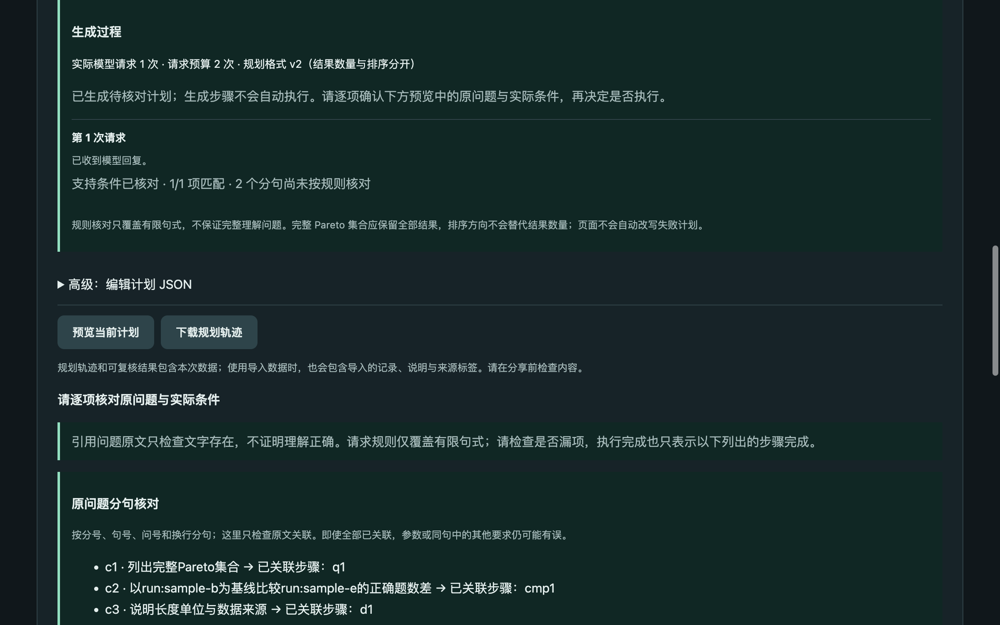

# v0.9：把结果选择与排序分开

2026-10-16。v0.8 的四条完整 Pareto 失败都使用 `ranking=maximum, top_k=null`，旧编译器将 maximum 解释为极值，实际只取第一名。本轮增加显式选择范围，避免一个字段同时承担排序和截断。执行计划、数据发送选择和收据格式保持兼容。[五步计划](v0.9-plan.md) · [工作台说明](v0.9-workbench.md)。

**固定新题对照：旧格式 v1 首次及最终均 10/16 通过，新格式 v2 均 16/16。**这是两套规划协议在小型合成题上的结果，不是生产正确率、外部数据泛化或独立人工评审。v2 没有触发修正，本轮不能证明新增反馈提高了修正成功率。

## 本轮实现

- 模型提案 v2 分别表达 `order_by`、`direction` 与 `selection=all|top_k|extreme`。全集要求 `top_k=null`，前 N 条要求整数，极值由编译器明确取第一个排序值；保留并列独立设置。矛盾组合及旧 `metric/ranking` 字段被拒绝，不静默替模型修改选择范围。
- 有限规则冲突反馈提供模型可以修改的提案字段，如 `selection=all, top_k=null`。未核对的排序不被强行补成默认方向。最多两次真实请求，供应商异常不自动重试。
- v2 轨迹记录格式版本及实际发送的修正反馈；仅真正发出下一次请求时记录该反馈。原始消息、失败候选和实际请求数保留。旧 v1 提示、格式与反馈继续用于历史基线。
- 公开生成 API 默认使用 v2。页面展示每次生成的规则检查、错误及修正来源；失败候选明确标记，成功自动预览后仍需用户执行。更改问题、计划或数据会使旧展示失效。

## 冻结数据与方法

[8 道新题与字面预期](../evaluation/v0.9/cases.json) · [评分范围](../evaluation/v0.9/rubric.md) · [输入数据](../evaluation/v0.9/fixtures)。Atlas 有 8 条人工记录，以空格词数为单位；Lyra 有 6 条人工记录，以声明的合成 tokenizer 计数为单位。没有实际训练、推理测量或分词器运行。完整/筛选/空 Pareto、Pareto 内前 N 条与极值、token 筛选、普通排序及最短并列分别检查。预期参数、成员、必要顺序、比较差值及资料说明均提前写定。

真实请求前冻结提交 `1b503a6043153296b55d56a92503d7f1971bbca6` 的 39 个源文件、数据、评分代码及题目，并单独保存两个协议的系统提示和 schema。评测读取冻结快照和题目，Python 运行模块在本轮运行期间未改变；事后逐文件核对冻结字节、工作区和该提交一致。[manifest](evaluations/v0.9/holdout/manifest.json) · [冻结源码](evaluations/v0.9/holdout/frozen-source) · [来源审计](evaluations/v0.9/source-audit.json)。后续仅调整页面文字及交付文档。

DeepInfra `Qwen/Qwen3-235B-A22B-Instruct-2507`，temperature=0，max_tokens=2600，单请求超时90秒；提供方后端 revision 不可见。每题两种协议各独立运行两次，共32个 draw，每个最多2次请求，workers=4。失败不替换重跑。首次成绩是对原始第一条回复做本地单次预算重放，不增加模型采样或费用。

比较对象是**提示、schema、编译与版本对应修正指引的整体协议**，无法单独归因某个字段或提示句。对同一题重复两次也不等于16道独立题；并发耗时不是受控性能基准。

## 新题结果

| 任务（每组各两次） | v1 合同通过 | v2 合同通过 |
| --- | --- | --- |
| Atlas 完整 Pareto | 0/2 | 2/2 |
| Atlas 正确数与词数筛选后的完整 Pareto | 0/2 | 2/2 |
| Atlas Pareto 内前2条及边界并列 | 2/2 | 2/2 |
| Atlas Pareto 内准确率最高 | 2/2 | 2/2 |
| Atlas 空 Pareto | 2/2 | 2/2 |
| Lyra token 长度筛选后的完整 Pareto | 0/2 | 2/2 |
| Atlas 普通最短前2条及边界并列 | 2/2 | 2/2 |
| Lyra 普通最短全部并列 | 2/2 | 2/2 |

| 指标 | v1 旧格式 | v2 新格式 |
| --- | --- | --- |
| 首次 / 最终合同通过 | 10/16 · 10/16 | 16/16 · 16/16 |
| 实际请求 / 其中修正 | 20 / 4 | 16 / 0 |
| 修正后成功 | 0/4 | 未触发 |
| 收据重算通过 | 12/12 份产物 | 16/16 份产物 |
| 提供方报告 prompt / completion tokens | 70,828 / 2,928 | 58,836 / 2,652 |
| 提供方报告估计费用 | $0.00798492 | $0.00675384 |
| 延迟中位数（并发） | 13.051秒 | 15.3975秒 |

新题共36次请求，报告估计费用 $0.01473876，无未知用量。费用是提供方返回估计，非结算账单。两套协议各自实际请求数不同，是固定上限内发生修正的结果；没有额外补抽样。

[汇总与逐条判定](evaluations/v0.9/holdout/summary.json) · [全部轨迹](evaluations/v0.9/holdout) · [第二位助手逐条复核](evaluations/v0.9/holdout/second-assistant-review.json)。复核者自行重算了成员、比较差值和数据绑定，没有调用评分器，但参与了评测实现且知道协议标签，属于助手非盲复核，不是独立人工或独立作者审核。

## 六条旧格式失败与解释边界

Atlas 完整及筛选 Pareto 的四条失败仍使用 maximum，将完整集合截成 `top_k=1`。两次请求后冲突未解决，最终拒绝执行；其中一条调整了其他提案内容但未纠正截断。四条开发中见过的 v0.8 原始失败仍保留在旧报告，没有替换历史成绩。

Lyra token Pareto 的两条旧格式结果更能说明边界：有限中文规则不覆盖该 token 阈值句式，状态为未核对；系统执行了被截断的计划，收据也能重算，但只返回 `run:lyra-02`，漏掉 `03/04/06`，因此合同失败。**内部一致性不等于任务正确性。**不能把12份旧格式可验证产物算成12次任务成功。

v2 对这三类要求都使用全部结果，同时保留 top-k 与极值控制题的正确行为。变化发生在首次输出，而非真实失败后的修正。工程测试覆盖了错误选择后的正确反馈与有限预算；本轮仍没有“新反馈在真实失败中成功救回”的证据，也没有扩展有限规则到任意自然语言。

## 开发回归、页面与工程验证

- v0.8 A/B 两道已知 Pareto 题单独作为[开发回归](evaluations/v0.9/dev)：v2首次2/2通过、2次请求、0次修正，报告费用 $0.00074923。它们不计入新题32个 draw。
- [离线参考计划](evaluations/v0.9/offline-oracle)8/8通过且8份重算，0次模型调用；参考计划通过仅是工程检查。
- **311项测试通过**，比v0.8增加64项，包含选择范围/并列、矛盾组合、旧失败重放、API默认版本、修正反馈和预算、冻结与反例评分。55份v0.5–v0.8历史计划收据仍兼容。
- 独立浏览器会话用3条**模拟生成响应**检查成功/失败/服务错误、文本安全、修正反馈显示、修改后失效与390px布局；模拟不计入模型成绩。
- 另一次[真实页面流程](evaluations/v0.9/browser)导入A快照，完整Pareto得到b/d/e，比较b→e为−15题；手动执行3步，下载并上传复核通过。v2一次请求，报告费用 $0.00037421；控制台无错误警告、390px无横向溢出。该调用单列，不计入评测分数。

含开发回归和真实页面在内，本轮共39次模型请求，报告估计费用 $0.01586220。全部调用的原始回复和用量均保留。



## 复现与后续

```bash
pytest -q
# 离线参考计划：零模型请求
python scripts/evaluate_selection.py --strategies v2
# 新题：32个draw，最多64次真实请求，会产生费用
python scripts/evaluate_selection.py --live --suite holdout --strategies both --repeats 2 --workers 4
# 已知开发回归单列
python scripts/evaluate_selection.py --live --suite dev --strategies v2 --repeats 1
lablens verify docs/evaluations/v0.9/browser/live-receipt.json
```

本轮解决可复现的选择范围表达问题；[通用意图校验 Issue 10](https://github.com/N7766/lablens-agent/issues/10)继续开放。下一阶段应优先获取第二个真实实验项目的导入样本与独立人工题目/审核，并检验尚未覆盖的表达。已有两份新快照仍是合成数据。服务维持本地单用户定位，没有公网鉴权、用户隔离、费用配额或生产运行证据。
