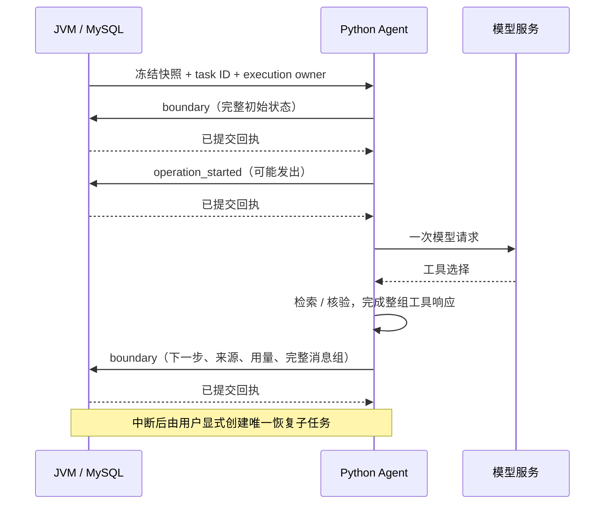

# 工具边界恢复与有界用户历史

恢复用于进程退出后继续一次已批准的 Agent 任务。MySQL保存检查点，JVM负责执行身份、租约与准入，Python负责检查状态、恢复工具循环，浏览器负责明确确认。它不提供供应商请求的exactly-once执行，也不能确认断连后的计费。

## 启用与操作

候选JVM设置 `LABLENS_CHECKPOINTS_ENABLED=true`；Python设置 `LABLENS_CHECKPOINT_BASE_URL=http://127.0.0.1:8081`，隔离端口需对应修改。两端必须使用同一有效 `LABLENS_SERVICE_KEY`。功能默认关闭以兼容旧worker；仅配置Python地址不启用恢复。服务地址必须是明确的loopback IP，不接受模型或浏览器指定回调URL。

在失败或已确认取消的Agent任务中打开“检查中断与恢复”。页面先GET持久状态；有完整边界时，需要重新勾选原任务快照的发送许可，才能点击“从检查点继续”。它会创建一个关联子任务，原任务不改写。点击“准备新任务重试”仍是另一条路径：使用当前资料，重新执行全部步骤。

网络断开导致提交结果未知时，页面只GET核对唯一子任务，不自动重发POST。已存在的子任务可直接查看。未知外部请求不提供“强行恢复”按钮；应先核对供应商请求、日志和用量，决定是否另建明确批准的新任务。本轮没有供应商账单自动对账接口。

## 持久协议

`POST /api/internal/tasks/{id}/checkpoint` 只接受独立服务密钥和 `X-LabLens-Execution-Owner`，不接受浏览器cookie、Origin或Bearer身份。事务锁住任务行，每次写入都要求RUNNING、同owner及未过期租约。版本递增，重复相同版本和摘要可以返回原回执，但worker不会自动HTTP重试。

V11新增 `task_checkpoints` 和任务 `parent_task_id` 唯一索引。`boundary`保存最大512KiB的规范JSON字符串及其SHA256；字符串保留跨语言数字和转义的精确字节。`operation_started`只记录有界操作ID，意味着请求**可能**已经发出。它与远端调用不在同一事务内；即使请求尚未真正发送，也保守阻止恢复。连续决策、embedding、复核分别落操作回执，直到完整工具批次再次提交边界。

只保存完整assistant工具调用与全部tool回复。重启恢复的内容包括已观察/已核验来源、搜索记录、完整消息组、已用调用ID、下一决策步、已知用量和上下文选择记录。恢复前验证原请求、运行源码/模型配置、来源哈希和消息配对；任一不符就结束，不能靠旧引用ID冒充当前可见证据。

## 恢复事务与预算

`GET /api/workspaces/{w}/tasks/{id}/recovery` 返回元数据，不返回执行身份。`POST .../resume` 要求 `Idempotency-Key`、`approved_snapshot_id`、`expected_checkpoint_revision`。按现有global guard→workspace锁序重新检查权限与活动队列上限，在同一事务中创建子任务和Outbox。父任务唯一索引阻止并发创建两个恢复分支。已完成任务、未知请求、非Agent、较新会话轮次及恢复子任务都不能再恢复。

子任务沿用父任务冻结的资料、会话和记忆；当前资料变更不会偷换旧快照。执行开始仍检查选中记忆的到期；本轮不把原快照变为当前版本，也不恢复已过期记忆。子任务不增加会话轮次，原会话出现新轮次后拒绝恢复；活跃子任务会阻止该会话的新提交。恢复结果通过任务历史及父子链接查看。原会话轮次保留原中断状态，后续会话上下文不会自动并入恢复子任务的报告；本轮实现的是任务恢复分支。

调用步数、工具次数、已知token和活动时间累计，不因重启归零。人工等待/进程离线时间不计入活动预算。边界回执丢失时无法知道实际等待多久，因此保存的已用时间额外计入最多3秒回调预留，恢复时保守扣除；这是预算约定，不是实际耗时测量。恢复的Agent `latency_ms`为该累计活动预算口径，JVM `worker_ms`仍是子任务本次worker请求耗时。恢复子任务绕过结果缓存读写。

父任务若因连接断开保留“用量未知”，子任务会携带检查点中已知用量和后续用量。报告 `result.usage` 为累计口径，不能与父任务直接相加；JVM核对冻结检查点后，把 `execution_usage` 保存为子任务增量。若任一计数未知，差值仍保留未知。恢复校验前失败的 `usage_scope` 标明只涉及当前执行，不把未验证状态当成已用计费。如果报告已生成但最终任务结果未入库，最后操作仍处于pending，保守阻止重跑复核。本轮最多一层恢复；不声称已实现任意深度工作流或模型账单结算。

## 有界历史摘要

摘要采用提取式记录：保留早期用户原话、序号、资料快照和SHA256，移除早期助手回答。没有调用LLM改写历史，否定、纠正、约束和未完成目标不会被压缩成模型推测。新问题的明确纠正优先；摘要始终是未验证的用户上下文，不是原文证据或长期记忆。

JVM为最近20轮之外的终态用户消息生成最多100条、16KiB的摘要。Python预算需要删除近期完整轮次时，把被移除的用户原话合入同一摘要，只丢弃助手答案。最后两轮保留完整消息。JVM也提前检查最终复核合并后的摘要容量，因此100条上限适用于所有被合并的用户消息，不代表可以另加20条而无条件受理。最终复核同样收到用户摘要，但不会把它加入证据目录。

容量不足或历史缺失时拒绝新增会话任务或在请求前以`context_budget_exceeded`结束；用户应新建会话并明确重述目标、限制和未决问题。旧快照若本来没有保存被省略历史，只能标记不可恢复，不能凭空补全。此设计节省助手长回答的上下文，不承诺无限记忆或精确模型token数；预算仍使用保守UTF-8字节估计。

实现与一次受控故障验收见[第十八轮](conversation-round18.md)。测试使用固定响应，不能推导真实模型语义准确率、生产SLA或商业流量规模。
